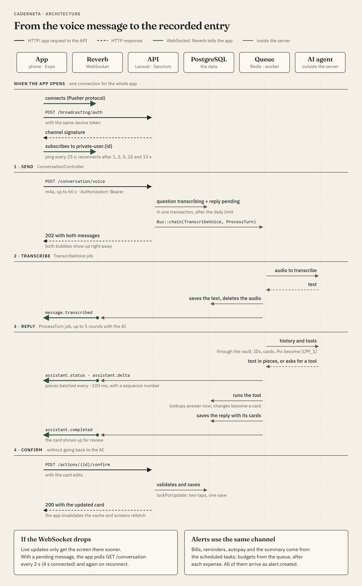

<p align="center"></p>

<h1 align="center">Caderneta</h1>

<p align="center"><b>Your home in order. No hassle.</b><br>Log your expenses, track your income and spending, and keep your household finances organized in a simple, intuitive way.</p>

<p align="center"><a href="README.md">Português</a> · <b>English</b></p>

A household finance app you use by talking. You say "I spent 42 on lunch and 18 on coffee, debit", the assistant understands, builds a card with the entries and waits for your confirmation. Behind it, the app handles credit cards and invoices, recurring bills, budgets, lists and reminders, and warns you in the chat before a bill is due. It is built for a household with several people, each with their own role.

*"Caderneta" is the small notebook Brazilian families have always used to write down the household money. The app's interface is in Brazilian Portuguese.*

> **The app's code is private.** This repository is the project's showcase: what the app does and the design and architecture decisions. To talk about the code, reach me on [LinkedIn](https://www.linkedin.com/in/leonardo-ferreira-de-souza/).


<p align="center">
  
  
  
  
</p>

<p align="center">Documentation (in Portuguese): <a href="https://leo-o-nardo.github.io/caderneta/design-guide.html">Design guide</a> · <a href="https://leo-o-nardo.github.io/caderneta/icone-caderneta.html">The icon</a> · <a href="https://leo-o-nardo.github.io/caderneta/apresentacao.html">How it works inside</a></p>

---

## Overview

The idea is to keep the simplicity of writing down, adding up and remembering, without the work of doing it all by hand. Instead of filling in a form for every expense, you just talk to the assistant, which logs the information and helps keep everything organized.

Three things guided the project:

- **Talking is the main way to use it.** The microphone sits at the center of the home screen. Voice becomes text, text becomes entries, and nothing is saved until you review it.
- **The household belongs to several people.** Each one has their own login and role, and chooses what is shared with the household and what is private.
- **The money has to be right.** Amounts in integer cents, dates in each person's time zone, invoices calculated from the card's closing day, and estimates always marked as estimates.

## Design and brand

The visual design follows its own guide, **Caderneta**: light paper, dark ink, a thin rule between the lines and numbers aligned like in a ledger. Color only shows up when it means something. Two documents (in Portuguese) walk through these decisions in detail:

<table>
  <tr>
    <td width="50%" valign="top">
      <a href="https://leo-o-nardo.github.io/caderneta/design-guide.html"></a>
      <p><b><a href="https://leo-o-nardo.github.io/caderneta/design-guide.html">Design guide</a></b></p>
      <p>The app's visual reference: every new or changed screen follows it, and a rule only changes after it changes in the guide. It covers the approved decisions and the reason behind each one, the palette with measured contrast, typography, space and shape, the three main screens with the reason behind each choice, components, micro-interactions, the guidelines for new screens and the log of every version.</p>
    </td>
    <td width="50%" valign="top">
      <a href="https://leo-o-nardo.github.io/caderneta/icone-caderneta.html"></a>
      <p><b><a href="https://leo-o-nardo.github.io/caderneta/icone-caderneta.html">The Caderneta icon</a></b></p>
      <p>The brand presentation: the icon everywhere it appears (iPhone, Android, themed icon, splash and the home screen at real size), the opening animation playing, with slow motion, the parts of the icon and why this one, the path from the first sketch to the decision, and how the files are generated.</p>
    </td>
  </tr>
</table>

Both are published on GitHub Pages, along with the architecture diagram, in the [Caderneta documentation](https://leo-o-nardo.github.io/caderneta/). They also open straight in the browser from the `docs/` folder.

**The icon:** the notebook cover in moss green, with the ink elastic band near the edge and, written on it, the Fraunces "C" with the double rule you draw under a finished sum.

<p align="center"></p>

**The opening:** the splash icon grows until it becomes the cover; when the app is ready, the elastic is pulled aside and the cover opens over the screen. When signed in, the cover waits for the home screen's data, for up to 3 s, so it opens over the complete screen. A tap skips the animation.

**Colors**

| Name | Color | Use |
|---|---|---|
| Papel (paper) | `#F4F0E8` | The background of every screen. |
| Tinta (ink) | `#1E1F1C` | Main text and the main button. |
| Grafite (graphite) | `#5F5B52` | Captions, dates and details. |
| Musgo (moss) | `#2C5440` | Actions, selection and incoming money. It is the brand color. |
| Mostarda and Atenção (mustard and warning) | `#D9A53A` · `#7F5A0C` | What needs attention, like a budget from 80% on. |
| Tijolo (brick) | `#A63A25` | Overdue, over budget, errors and delete. |

Categories use 14 pigment tones (Louro, Ardósia, Ameixa, Telha…), only ever on the category icon.

**Typography:** Fraunces for titles and large amounts; IBM Plex Sans for everything else. Amounts in R$ use tabular figures, so columns line up.

**Principles**
- **Rules, not boxes:** lists and sections sit directly on the paper, separated by the rule. The only box is the chat card.
- **One main number per screen**, everything else smaller.
- **Icons like on a Kindle:** thin strokes, always with a word next to them.
- **Forms with the button pinned to the bottom**, always within reach, and "Delete" far from it, at the end.
- **Confirmations in the app's own bottom sheet**, which says what happens to the numbers ("Leaves October's totals").
- **Accessibility:** 4.5:1 contrast for text, 44-point touch targets, screen reader labels on every icon button, and "Reduce motion" respected.

## Highlights

### Talk and log
- **Voice:** tap the microphone, speak (up to 1 minute) and tap again to send. The AI agent transcribes it and the message shows up in the chat.
- **The assistant answers live:** the reply streams in over WebSocket while it is being written.
- **Cards to review:** what the assistant proposes appears in an editable card (amount, category, date, payment method) with "Confirm" and "Cancel".
- **You can also type** in the chat, or log by hand with the form.

### What the assistant can do
- Log expenses and income, including installment purchases on a credit card.
- Mark a bill as paid, fix or delete an entry.
- Look up spending by period, category or card, and draw charts.
- Create recurring bills, recurring income (like a salary), budgets, lists and reminders.
- Add and check items on lists ("put milk and coffee on the list").
- It does not give investment advice.

### The household
- **Roles:** owner, member and read-only.
- **Invitations** by link and by a 6-character code, valid for 7 days.
- **Private or shared:** every entry, list and reminder can belong only to whoever created it.
- **Several households per person:** the family one and the one shared with roommates, for example.
- **Cards per person:** each member has their own, and purchases land on the right card.

### Money
- **Entries** with category, payment method and card, filtered by month and searchable.
- **Installments:** a purchase in the past creates every installment on the right invoices.
- **Invoices** per card, with closing day, due date and how much of it is installments.
- **Recurring bills:** fixed or variable amounts (the estimate is the average of the last 3 payments), skip a month, undo a payment, and autopay, which logs the expense by itself on the due date.
- **Recurring income:** the salary comes in by itself every month, on the right day.
- **Budgets** per category, with the average of the last months as a suggestion.
- **Categories** with icon, color and order, shown in a grid when logging.
- **Monthly summary:** balance, income and expenses, spending by category, who spent how much, invoices and upcoming bills.

### Schedule, lists and reminders
- **Schedule** with bills, cards and reminders in one place.
- **Reminders** that repeat ("every 6 months"), shared with the household or private.
- **Lists** for groceries, wishes, to-dos or anything else, with tap-to-check for the supermarket.

### Alerts in the chat and on the phone
- Each alert arrives in the chat and, with notifications on, also as a push notification. Tapping it opens the chat of the right household.
- Bills on the day before and on the due date.
- Autopay logged (or asking for the amount, when it changes every month).
- Budget reaching 80% and going over 100%.
- Weekly summary, on Sunday evening.
- Reminders at the scheduled time, with "Done", "Snooze 1 h" and "Tomorrow".
- Each kind of alert can be turned off.

### Access and security
- **Sign-up with approval:** whoever signs up alone waits for the administrator. The administrator gets an e-mail with a signed link to an approval page.
- **Invitations get in right away:** people who come through an invitation join immediately, and the administrator is only notified.
- **Forgot password** with a 6-digit code by e-mail.
- **One session per device**, with "sign out of all devices".
- **Privacy before the AI:** CPF and CNPJ (Brazilian tax IDs), card numbers, Pix keys, phone numbers, e-mails, bank branch and account are replaced by markers before any text reaches the model.
- **Limits:** messages per person per day, and a log of AI usage and cost.

## Architecture

The app **asks through the API** (HTTP) and **listens through Reverb** (WebSocket); anything slow (the AI, transcription, e-mails) leaves the request and runs in the queue. The drawing follows the path from the voice message to the recorded entry:

<p align="center"><a href="https://leo-o-nardo.github.io/caderneta/arquitetura.html?lang=en"></a></p>

To go deeper, the page [How it works inside](https://leo-o-nardo.github.io/caderneta/apresentacao.html) (in Portuguese) explains the architecture for people who do not know the code: the parts, the path of a request and of a voice message, and the privacy vault.

## Under the hood

### Three ways to act
Not every action of the assistant needs the same care, so they fall into three levels:

| Level | Examples | How it works |
|---|---|---|
| Confirm | log expenses, installments, pay a bill, fix an entry | The card shows up editable and nothing is saved before "Confirm". |
| Explicit | delete an entry, delete a list | The card shows the impact ("leaves October's totals") before confirming. |
| Immediate, with undo | list items, reminders, recurring bills, budgets | Done right away, with "Undo" for 2 minutes. |

The key decision: **the confirmation never goes back to the AI**. When the model proposes an action, the app validates the data with its own rules and stores a pending action that is ready to save. When you tap "Confirm", the app saves exactly what is on the card (with your edits). The model never gets a second chance to make up an amount at save time.

### Privacy before the AI
Every text sent to the AI, typed or transcribed, first goes through a vault (`SecureDataVault`):

- CPF and CNPJ are recognized by their check digits, and card numbers by the Luhn algorithm, so any long number is not mistaken for one.
- Each value becomes a marker, like `[CPF_1]` or `[CARTAO_1]`. The model works with the marker, and the reply comes back with the original value, even in the middle of streamed text.
- The vault wraps any AI provider, so switching models does not open a gap.
- Tool calls are sent back to the model exactly as it sent them, still masked, so the thought signature the provider requires stays valid.
- Household members' names stay visible: the assistant needs them to understand "Ana paid the electricity bill".

### Design as a system
The visual design follows its own guide, "Caderneta" (see [Design and brand](#design-and-brand)). Two pieces show how seriously it was taken:

- **The icon comes from a script with no dependencies.** `scripts/brand-icons.mjs` reads the outline of the "C" straight from the Fraunces font file, builds the icon, draws the PNGs with its own rasterizer and also writes the paths the app uses.
- **The opening animation is code, not a video.** It starts exactly like the system splash screen (the same drawing, in the same place), waits for the app to be ready without a seam, and ends by revealing the real screen. A video could do none of those three things.

## Stack

| Layer | Technologies |
|---|---|
| App | Expo SDK 57, React Native 0.86 (New Architecture), React 19, TypeScript, Expo Router, TanStack Query, Zustand, Reanimated 4, react-native-svg, expo-audio |
| API | PHP 8.4, Laravel 13, Sanctum (token per device), Pest |
| Real time | Laravel Reverb (WebSocket) |
| Assistant | AI agent with tools (chat, actions and voice transcription), behind a provider interface, and a rule-based "fake" provider for development and tests |
| Data | PostgreSQL 16, Redis 7 (queue and cache) |
| Infra | Docker Compose, Nginx, PHP-FPM, Mailpit |

## Tests and quality

The backend has API, rules and assistant tests (Pest), which run on a separate database and always with the "fake" assistant, so they never spend the AI key. The app has tests for its rules (Jest). On every push, CI runs the tests on both sides, PHP code style (Pint), types, ESLint, and checks that the brand files match the script that generates them.

## API

All routes live under `/api/v1` and, except for sign-in and sign-up, require the device token (`Authorization: Bearer`).

| Group | Main routes |
|---|---|
| Sign-in | `POST /auth/register`, `/auth/login`, `/auth/forgot-password`, `/auth/reset-password`, `/auth/logout`, `/auth/logout-all` |
| Account | `GET`, `PATCH` and `DELETE /me`, `PUT /me/password` |
| Household | `/households`, `/household`, `/household/members/{member}`, `/household/invitations`, `/invitations/{code}/accept` |
| Entries | `/transactions`, `/installment-plans`, `/categories`, `PUT /categories/order` |
| Cards and bills | `/cards`, `GET /cards/{card}/invoice`, `/bills`, `POST /bills/{bill}/pay`, `/bills/{bill}/skip`, `/recurring-incomes` |
| Budgets and summary | `/budgets/{category}`, `GET /summary` |
| Schedule and lists | `/reminders`, `/reminders/{reminder}/done`, `/lists`, `/lists/{list}/items`, `/list-items/{item}` |
| Assistant | `GET /conversation`, `POST /conversation/messages`, `POST /conversation/voice`, `POST /conversation/messages/{message}/report`, `POST /actions/{action}/confirm`, `/cancel`, `/undo` |
| Alerts | `GET /alerts/unread`, `POST /alerts/seen`, `POST /alerts/{message}/{action}`, `POST /push-tokens` |

## Code structure

How the private repository is organized:

```text
├── docker-compose.yml          # app, queue, scheduler, reverb, nginx, postgres, redis, mailpit
├── docker/                     # PHP Dockerfile, Nginx and the test database
├── scripts/brand-icons.mjs     # generates the icon, the splash and the brand paths
├── docs/                       # design guide, icon, architecture, presentation and the technical docs
├── backend/                    # Laravel API
│   ├── app/
│   │   ├── Assistant/          # the assistant: providers, tools, actions, privacy vault, voice
│   │   ├── Alerts/             # bill, budget, weekly summary and reminder alerts
│   │   ├── Services/           # rules for entries, installments, bills, budgets and access
│   │   ├── Http/               # API controllers, requests and resources
│   │   ├── Mail/               # the Caderneta-style e-mail
│   │   └── Notifications/      # sign-up, access approved, password code
│   ├── database/               # migrations, factories and the demo household
│   ├── resources/views/        # e-mails and the sign-up approval page
│   └── tests/                  # API, rules and assistant tests (Pest)
└── mobile/                     # Expo app
    ├── assets/                 # icon, splash and the brand in SVG
    └── src/
        ├── app/                # screens (Expo Router)
        ├── api/                # API calls and cache (TanStack Query)
        ├── components/         # screen parts, chat cards and the guide components (ui/)
        ├── lib/                # app rules, with tests
        ├── stores/             # session, confirmation and chat state (Zustand)
        └── theme/              # guide tokens and the brand drawing
```

## Limitations and next steps

- **Invitation:** it carries only the 6-character code; there is no link that opens the app directly yet.
- **Release:** the app is in review on the Play Store and the App Store. The production server runs with Docker Compose.

## Author

**Leonardo Ferreira** · [LinkedIn](https://www.linkedin.com/in/leonardo-ferreira-de-souza/) · [GitHub](https://github.com/Leo-o-Nardo)

## Use of this material

© 2026 Leonardo Ferreira. All rights reserved.

The app's code is private. The texts, images, the Caderneta name and the icon in this repository are here for reading and evaluation. To use, copy or distribute any part of it, please contact me first on [LinkedIn](https://www.linkedin.com/in/leonardo-ferreira-de-souza/) or at leonard.ofs351@gmail.com.

The Fraunces and IBM Plex Sans fonts (SIL Open Font License) and the Lucide icons (ISC) follow their own licenses.
