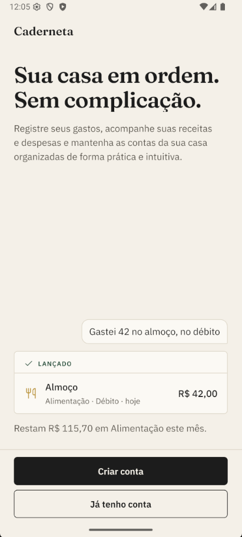
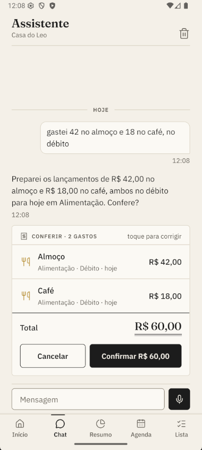
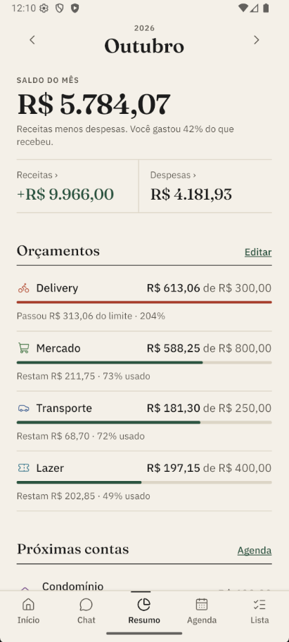
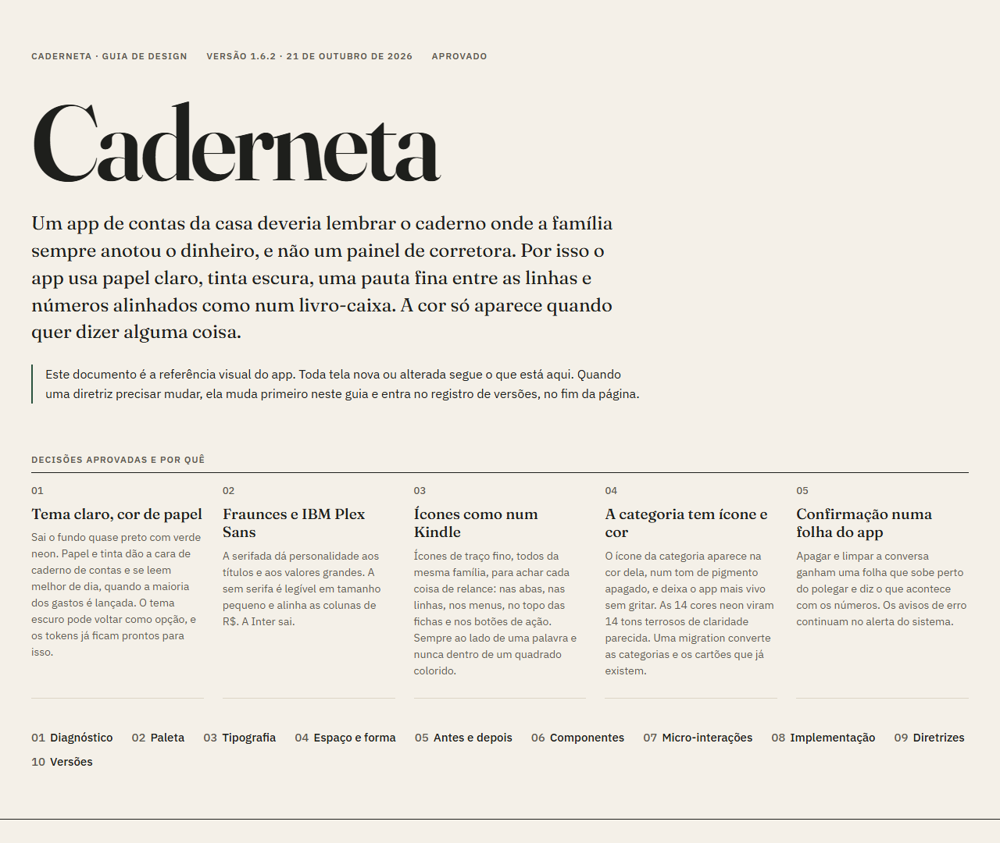
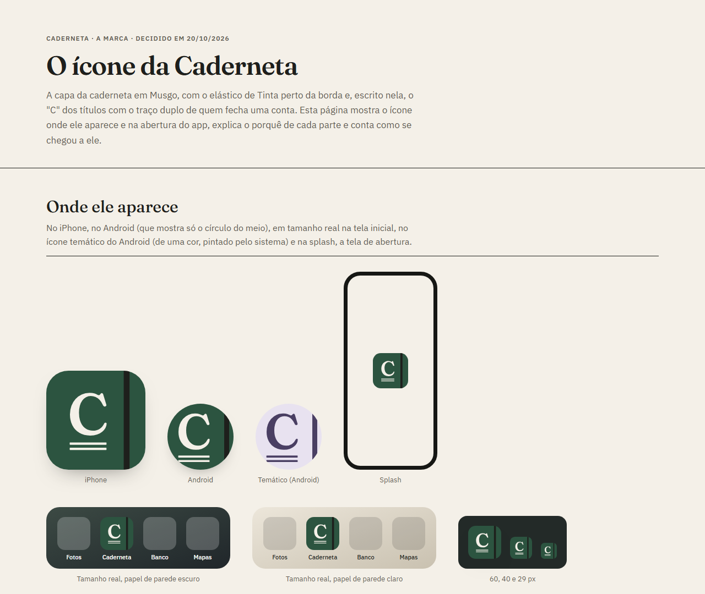
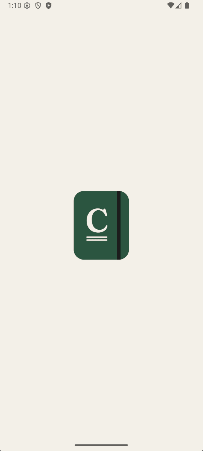
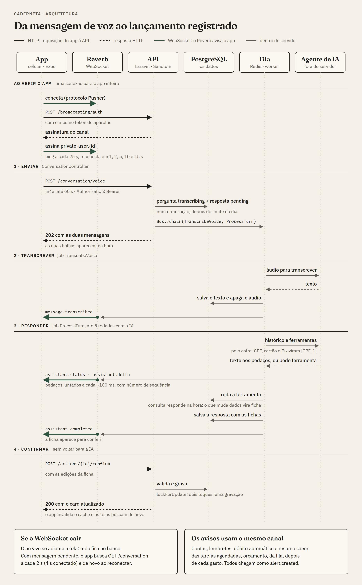

<p align="center"></p>

<h1 align="center">Caderneta</h1>

<p align="center"><b>Sua casa em ordem. Sem complicação.</b><br>Registre seus gastos, acompanhe suas receitas e despesas e mantenha as contas da sua casa organizadas de forma prática e intuitiva.</p>

<p align="center"><b>Português</b> · <a href="README.en.md">English</a></p>

Um app de finanças da casa para usar falando. A pessoa diz "gastei 42 no almoço e 18 no café, no débito", o assistente entende, monta uma ficha com os lançamentos e espera a confirmação. Por trás, o app cuida de cartões e faturas, contas fixas, orçamentos, listas e lembretes, e avisa antes de uma conta vencer. Tudo pensado para uma casa com várias pessoas, cada uma com o seu papel.

[](https://github.com/Leo-o-Nardo/caderneta/actions/workflows/ci.yml)


<p align="center">
  
  
  
  
</p>

<p align="center">Documentação: <a href="https://leo-o-nardo.github.io/caderneta/design-guide.html">Guia de design</a> · <a href="https://leo-o-nardo.github.io/caderneta/icone-caderneta.html">O ícone</a> · <a href="https://leo-o-nardo.github.io/caderneta/apresentacao.html">Como funciona por dentro</a> · <a href="docs/tecnico/README.md">Documentação técnica</a></p>

---

## Visão geral

A proposta é manter a simplicidade de anotar, somar e lembrar, mas sem o trabalho de fazer tudo manualmente. Em vez de preencher formulários a cada gasto, basta conversar com o assistente, que registra as informações e ajuda a manter tudo organizado.

Três coisas guiaram o projeto:

- **Falar é o jeito principal de usar.** O microfone fica no centro do Início. A voz vira texto, o texto vira lançamentos, e nada é gravado sem a pessoa conferir.
- **A casa é de várias pessoas.** Cada uma tem o seu login e o seu papel, e escolhe o que é da casa e o que é só dela.
- **O dinheiro precisa estar certo.** Valores em centavos inteiros, datas no fuso de cada pessoa, faturas calculadas pela data de fechamento do cartão e estimativas sempre marcadas como estimativa.

## Design e marca

O visual segue um guia próprio, a **Caderneta**: papel claro, tinta escura, uma pauta fina entre as linhas e números alinhados como num livro-caixa. A cor só aparece quando quer dizer alguma coisa. Dois documentos contam essas decisões em detalhe:

<table>
  <tr>
    <td width="50%" valign="top">
      <a href="https://leo-o-nardo.github.io/caderneta/design-guide.html"></a>
      <p><b><a href="https://leo-o-nardo.github.io/caderneta/design-guide.html">Guia de design</a></b></p>
      <p>A referência visual do app: toda tela nova ou alterada segue o que está nele, e uma regra só muda depois de mudar no guia. Traz as decisões aprovadas e o porquê de cada uma, a paleta com o contraste medido, a tipografia, espaço e forma, o antes e depois das telas, os componentes, as micro-interações, as diretrizes para telas novas e o registro de cada versão.</p>
    </td>
    <td width="50%" valign="top">
      <a href="https://leo-o-nardo.github.io/caderneta/icone-caderneta.html"></a>
      <p><b><a href="https://leo-o-nardo.github.io/caderneta/icone-caderneta.html">O ícone da Caderneta</a></b></p>
      <p>A apresentação da marca: o ícone em cada lugar onde aparece (iPhone, Android, ícone temático, splash e a tela inicial em tamanho real), a abertura do app tocando, com câmera lenta, as partes do ícone e o porquê deste, o caminho do primeiro esboço até a decisão e como os arquivos são gerados.</p>
    </td>
  </tr>
</table>

Os dois estão publicados no GitHub Pages, junto com o diagrama da arquitetura, na [documentação da Caderneta](https://leo-o-nardo.github.io/caderneta/). Também abrem direto no navegador a partir da pasta `docs/`.

**O ícone:** a capa da caderneta em Musgo, com o elástico de Tinta perto da borda e, escrito nela, o "C" da Fraunces com o traço duplo de quem fecha uma conta.

<p align="center"></p>

**A abertura:** o ícone da splash cresce até virar a capa; quando o app fica pronto, o elástico é puxado para o lado e a capa se abre sobre a tela. Com login, a capa espera os dados do Início, por até 3 s, para abrir sobre a tela completa. Um toque pula a animação.

**Cores**

| Nome | Cor | Uso |
|---|---|---|
| Papel | `#F4F0E8` | O fundo de todas as telas. |
| Tinta | `#1E1F1C` | Texto principal e botão principal. |
| Grafite | `#5F5B52` | Legendas, datas e detalhes. |
| Musgo | `#2C5440` | Ações, seleção e dinheiro que entra. É a cor da marca. |
| Mostarda e Atenção | `#D9A53A` · `#7F5A0C` | O que pede atenção, como o orçamento a partir de 80%. |
| Tijolo | `#A63A25` | Atrasada, estourou, erro e apagar. |

As categorias usam 14 tons de pigmento (Louro, Ardósia, Ameixa, Telha…), sempre só no ícone da categoria.

**Tipografia:** Fraunces nos títulos e nos valores grandes; IBM Plex Sans no resto. Os valores em R$ usam algarismos de mesma largura, para as colunas alinharem.

**Princípios**
- **Divisória, não caixa:** listas e seções ficam direto no papel, separadas pela pauta. A única caixa é a ficha do chat.
- **Um número principal por tela**, o resto em tamanhos menores.
- **Ícones como num Kindle:** traço fino, sempre com uma palavra ao lado.
- **Formulários com o botão preso embaixo**, sempre à mão, e "Apagar" longe dele, no fim.
- **Confirmações na folha do app**, que diz o que acontece com os números ("Sai dos totais de outubro").
- **Acessibilidade:** contraste de 4,5:1 nos textos, área de toque de 44, leitor de tela em todos os botões de ícone e "Reduzir movimento" respeitado.

## Principais pontos

### Falar e lançar
- **Voz:** toque no microfone, fale (até 1 minuto) e toque de novo para enviar. A transcrição é feita pelo agente de IA e a mensagem aparece no chat.
- **O assistente responde ao vivo:** a resposta chega aos poucos, por WebSocket, enquanto é escrita.
- **Fichas para conferir:** o que o assistente propõe aparece numa ficha editável (valor, categoria, data, forma de pagamento) com "Confirmar" e "Cancelar".
- **Também dá para digitar** no chat, ou lançar à mão pelo formulário.

### O que o assistente sabe fazer
- Lançar gastos e receitas, inclusive compras parceladas no cartão.
- Marcar uma conta como paga, corrigir ou apagar um lançamento.
- Consultar gastos por período, categoria ou cartão, e montar gráficos.
- Criar contas fixas, receitas fixas (como o salário), orçamentos, listas e lembretes.
- Colocar e marcar itens nas listas ("coloca leite e café na lista").
- Não dá conselho de investimento.

### A casa
- **Papéis:** dono, membro e só leitura.
- **Convites** por link e por código de 6 caracteres, válidos por 7 dias.
- **Privado ou da casa:** cada lançamento, lista e lembrete pode ser só de quem criou.
- **Várias casas por pessoa:** a da família e a que divide com quem mora junto, por exemplo.
- **Cartões por pessoa:** cada um tem os seus, e as compras caem no cartão certo.

### Dinheiro
- **Lançamentos** com categoria, forma de pagamento e cartão, filtros por mês e busca.
- **Parcelamentos:** uma compra no passado cria todas as parcelas nas faturas certas.
- **Faturas** por cartão, com fechamento, vencimento e quanto é de parcelas.
- **Contas fixas:** com valor fixo ou variável (a estimativa é a média dos últimos 3 pagamentos), pular um mês, desfazer um pagamento e débito automático, que lança a despesa sozinho no dia.
- **Receitas fixas:** o salário entra sozinho todo mês, no dia certo.
- **Orçamentos** por categoria, com a média dos últimos meses como sugestão.
- **Categorias** com ícone, cor e ordem, que aparecem numa grade na hora de lançar.
- **Resumo do mês:** saldo, receitas e despesas, gastos por categoria, quem gastou quanto, faturas e próximas contas.

### Agenda, listas e lembretes
- **Agenda** com contas, cartões e lembretes num lugar só.
- **Lembretes** com repetição ("a cada 6 meses"), da casa ou só seus.
- **Listas** de compras, desejos, coisas a fazer ou do jeito que você quiser, com toque para marcar no mercado.

### Avisos no chat
- Contas na véspera e no dia do vencimento.
- Débito automático lançado (ou pedindo o valor, quando ele muda todo mês).
- Orçamento chegando a 80% e passando de 100%.
- Resumo da semana, no domingo à noite.
- Lembretes na hora marcada, com "Feito", "Adiar 1 h" e "Amanhã".
- Cada tipo de aviso pode ser desligado.

### Acesso e segurança
- **Cadastro com liberação:** quem se cadastra sozinho espera o administrador liberar. Ele recebe um e-mail com um link assinado para uma página de aprovação.
- **Convite libera na hora:** quem chega por convite entra direto, e o administrador só é avisado.
- **Esqueci a senha** com código de 6 números por e-mail.
- **Sessão por aparelho**, com "sair de todos os aparelhos".
- **Privacidade antes da IA:** CPF, CNPJ, cartões, chaves Pix, telefones, e-mails, agência e conta são trocados por marcadores antes de qualquer texto chegar ao modelo.
- **Limites:** número de mensagens por pessoa por dia e registro do uso e do custo da IA.

## Arquitetura

O app **pede pela API** (HTTP) e **escuta pelo Reverb** (WebSocket); tudo que demora (a IA, a transcrição, os e-mails) sai da requisição e roda na fila. O desenho segue o caminho da mensagem de voz ao lançamento registrado:

<p align="center"><a href="https://leo-o-nardo.github.io/caderneta/arquitetura.html"></a></p>

Para ir mais fundo: a página [Como funciona por dentro](https://leo-o-nardo.github.io/caderneta/apresentacao.html) explica a arquitetura para quem não conhece o código, e a [documentação técnica](docs/tecnico/README.md) segue cada parte pelos arquivos e classes (o caminho de uma requisição, o assistente, os fluxos e o modelo de dados).

## Por dentro

### Três jeitos de agir
Nem toda ação do assistente pede o mesmo cuidado, então elas se dividem em três níveis:

| Nível | Exemplos | Como funciona |
|---|---|---|
| Confirmar | lançar gastos, parcelar, pagar conta, corrigir um lançamento | A ficha aparece editável e nada é gravado antes do "Confirmar". |
| Explícito | apagar um lançamento, apagar uma lista | A ficha mostra o impacto ("sai dos totais de outubro") antes de confirmar. |
| Imediato, com desfazer | itens de lista, lembretes, contas fixas, orçamentos | Feito na hora, com "Desfazer" por 2 minutos. |

A decisão importante: **a confirmação nunca volta para a IA**. Quando o modelo propõe uma ação, o app valida os dados com as regras dele e guarda uma ação pendente já pronta para gravar. Ao tocar em "Confirmar", o app grava exatamente o que está na ficha (com as edições da pessoa). O modelo não tem uma segunda chance de inventar um valor na hora de gravar.

### Privacidade antes da IA
Todo texto que vai para a IA, digitado ou transcrito, passa antes por um cofre (`SecureDataVault`):

- CPF e CNPJ são reconhecidos pelos dígitos verificadores, e cartões pelo algoritmo de Luhn, para não confundir com qualquer número comprido.
- Cada dado vira um marcador, como `[CPF_1]` ou `[CARTAO_1]`. O modelo trabalha com o marcador, e a resposta volta com o dado original, inclusive no meio do texto chegando ao vivo.
- O cofre envolve qualquer provedor de IA, então trocar de modelo não abre uma brecha.
- As chamadas de ferramenta são devolvidas ao modelo exatamente como ele as mandou, ainda mascaradas, para não invalidar a assinatura de raciocínio que o provedor exige.
- Os nomes dos membros da casa continuam visíveis: o assistente precisa deles para entender "a Ana pagou a luz".

### O design como sistema
O visual segue um guia próprio, a "Caderneta" (veja a seção [Design e marca](#design-e-marca)). Duas partes mostram como ele foi levado a sério:

- **O ícone sai de um script, sem dependências.** `scripts/brand-icons.mjs` lê o contorno do "C" direto do arquivo da fonte Fraunces, monta o ícone, desenha os PNG com um rasterizador próprio e grava também os caminhos que o app usa.
- **A abertura é feita em código, e não em vídeo.** Ela começa exatamente igual à splash do sistema (o mesmo desenho, no mesmo lugar), espera o app ficar pronto sem emenda e termina revelando a tela de verdade. Um vídeo não faria nenhuma das três coisas.

## Stack

| Camada | Tecnologias |
|---|---|
| App | Expo SDK 57, React Native 0.86 (New Architecture), React 19, TypeScript, Expo Router, TanStack Query, Zustand, Reanimated 4, react-native-svg, expo-audio |
| API | PHP 8.4, Laravel 13, Sanctum (token por aparelho), Pest |
| Tempo real | Laravel Reverb (WebSocket) |
| Assistente | Agente de IA com ferramentas (conversa, ações e transcrição de voz), atrás de uma interface de provedor, e um provedor "fake" por regras para desenvolvimento e testes |
| Dados | PostgreSQL 16, Redis 7 (fila e cache) |
| Infra | Docker Compose, Nginx, PHP-FPM, Mailpit |

## Como rodar

**Pré-requisitos:** Docker (no Windows, Docker Desktop com WSL2), Node.js 22 e, para o app, o Expo Go no celular ou um emulador Android. As portas 8100, 8180, 5433 e 8025 precisam estar livres.

### 1. Backend

```bash
git clone https://github.com/Leo-o-Nardo/caderneta.git
cd caderneta
cp backend/.env.example backend/.env

docker compose up -d --build
docker compose exec app composer install
docker compose exec app php artisan key:generate
docker compose exec app php artisan migrate --seed     # tabelas e a casa de demonstração
docker compose restart queue scheduler reverb
```

O último comando reinicia a fila, as tarefas agendadas e o Reverb para eles lerem o `.env` já com a chave da aplicação.

**O assistente funciona sem chave de IA.** Por padrão, `ASSISTANT_PROVIDER=fake` usa um assistente por regras, que entende frases como "gastei 30 no mercado". Para a IA de verdade e para a voz, troque o `ASSISTANT_PROVIDER` e preencha a chave do provedor no `backend/.env` (as variáveis estão no `backend/.env.example`) e reinicie com `docker compose restart app queue reverb`.

| Serviço | Endereço |
|---|---|
| API | http://localhost:8100/api/v1 |
| WebSocket (Reverb) | ws://localhost:8180 |
| Mailpit (e-mails de desenvolvimento) | http://localhost:8025 |
| PostgreSQL | localhost:5433 (usuário e senha `home_finance` / `secret`) |

### 2. App

```bash
cd mobile
cp .env.example .env
npm install
npx expo start
```

No `mobile/.env`, coloque em `EXPO_PUBLIC_REVERB_KEY` o mesmo valor de `REVERB_APP_KEY` do `backend/.env`. O endereço padrão (`10.0.2.2`) é o do PC visto pelo emulador Android; num celular de verdade, troque pelo IP do PC na rede.

### Dados de demonstração

O `migrate --seed` cria a casa do Leo, com três meses de lançamentos até hoje, cartões, contas fixas, orçamentos, listas e lembretes:

| Conta | Papel | Senha |
|---|---|---|
| `leo@example.com` | Dono | `password` |
| `ana@example.com` | Membro | `password` |

Para voltar ao estado inicial: `docker compose exec app php artisan migrate:fresh --seed`.

## Testes

```bash
docker compose exec app php artisan test     # backend: 295 testes (Pest)
docker compose exec app ./vendor/bin/pint     # estilo do código PHP
```

```bash
cd mobile
npm test              # app: 117 testes (Jest)
npx tsc --noEmit      # tipos
npm run lint          # ESLint
```

Os testes do backend rodam num banco separado (`home_finance_test`) e sempre com o assistente "fake", então não gastam a chave da IA.

## API

Todas as rotas ficam abaixo de `/api/v1` e, fora as de entrada, pedem o token do aparelho (`Authorization: Bearer`).

| Grupo | Rotas principais |
|---|---|
| Entrada | `POST /auth/register`, `/auth/login`, `/auth/forgot-password`, `/auth/reset-password`, `/auth/logout`, `/auth/logout-all` |
| Conta | `GET` e `PATCH /me`, `PUT /me/password` |
| Casa | `/households`, `/household`, `/household/members/{member}`, `/household/invitations`, `/invitations/{code}/accept` |
| Lançamentos | `/transactions`, `/installment-plans`, `/categories`, `PUT /categories/order` |
| Cartões e contas | `/cards`, `GET /cards/{card}/invoice`, `/bills`, `POST /bills/{bill}/pay`, `/bills/{bill}/skip`, `/recurring-incomes` |
| Orçamentos e resumo | `/budgets/{category}`, `GET /summary` |
| Agenda e listas | `/reminders`, `/reminders/{reminder}/done`, `/lists`, `/lists/{list}/items`, `/list-items/{item}` |
| Assistente | `GET /conversation`, `POST /conversation/messages`, `POST /conversation/voice`, `POST /actions/{action}/confirm`, `/cancel`, `/undo` |
| Avisos | `GET /alerts/unread`, `POST /alerts/seen`, `POST /alerts/{message}/{action}` |

## Estrutura

```text
├── docker-compose.yml          # app, fila, tarefas agendadas, reverb, nginx, postgres, redis, mailpit
├── docker/                     # Dockerfile do PHP, Nginx e o banco de testes
├── scripts/brand-icons.mjs     # gera o ícone, a splash e os caminhos da marca
├── docs/                       # guia de design, ícone, arquitetura, apresentação e tecnico/ (a documentação técnica)
├── backend/                    # API Laravel
│   ├── app/
│   │   ├── Assistant/          # o assistente: provedores, ferramentas, ações, cofre de privacidade, voz
│   │   ├── Alerts/             # avisos de contas, orçamentos, resumo da semana e lembretes
│   │   ├── Services/           # regras de lançamentos, parcelas, contas, orçamentos e acesso
│   │   ├── Http/               # controllers, requests e resources da API
│   │   ├── Mail/               # o e-mail no estilo Caderneta
│   │   └── Notifications/      # cadastro, acesso liberado, código de senha
│   ├── database/               # migrations, factories e a casa de demonstração
│   ├── resources/views/        # e-mails e a página de aprovação de cadastro
│   └── tests/                  # testes de API, regras e assistente (Pest)
└── mobile/                     # app Expo
    ├── assets/                 # ícone, splash e a marca em SVG
    └── src/
        ├── app/                # telas (Expo Router)
        ├── api/                # chamadas à API e cache (TanStack Query)
        ├── components/         # telas em partes, fichas do chat e os componentes do guia (ui/)
        ├── lib/                # regras do app, com testes
        ├── stores/             # sessão, confirmação e estado do chat (Zustand)
        └── theme/              # tokens do guia e o desenho da marca
```

## Limitações e próximos passos

- **Notificações push** ainda não existem: os avisos chegam no chat, e o push vem com o app publicado.
- **Convite:** vai só com o código de 6 caracteres; ainda não há link que abra o app direto.
- **Publicação:** o envio para a Play Store e a App Store é o próximo passo do roteiro. O servidor de produção roda com o `compose.prod.yml`, como descrito no [guia de deploy](docs/deploy.md).
- **Configuração de desenvolvimento:** o `docker-compose.yml` tem portas expostas e senhas padrão, pensadas só para rodar localmente.

## Autor

**Leonardo Ferreira** · [LinkedIn](https://www.linkedin.com/in/leonardo-ferreira-de-souza/) · [GitHub](https://github.com/Leo-o-Nardo)

## Uso do código

© 2026 Leonardo Ferreira. Todos os direitos reservados.

O código está público para leitura e avaliação. Para usar, copiar, modificar ou distribuir qualquer parte dele, inclusive o nome Caderneta e o ícone, fale comigo antes pelo [LinkedIn](https://www.linkedin.com/in/leonardo-ferreira-de-souza/) ou pelo e-mail leonard.ofs351@gmail.com.

As fontes Fraunces e IBM Plex Sans (SIL Open Font License) e os ícones Lucide (ISC) seguem as licenças deles.
