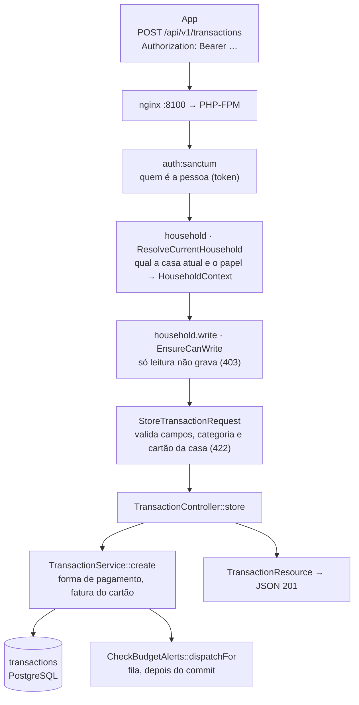
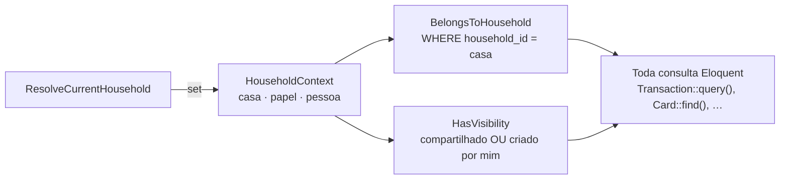

# 2. Backend

A API é um Laravel 13 organizado em camadas finas: a **rota** diz o que a requisição exige, o **middleware** descobre a casa e o papel da pessoa, o **Form Request** valida, o **controller** só orquestra, o **service** aplica a regra de negócio e o **model** grava. Este documento segue uma requisição de verdade por esse caminho e depois explica as peças que valem para todas: a casa como filtro, o login, as permissões e os erros.

## O caminho de uma requisição

Exemplo: o app lança um gasto com `POST /api/v1/transactions`.

Passo a passo, com o código de cada etapa:

1. **A rota** está em `backend/routes/api.php`, dentro de três grupos aninhados: `auth:sanctum`, depois `['household', 'household.write']`. É o `Route::apiResource('transactions', TransactionController::class)` que cria `index`, `store`, `show`, `update` e `destroy`.
2. **`auth:sanctum`** lê o token do cabeçalho `Authorization: Bearer` e acha a pessoa. Sem token válido, a resposta é **401**.
3. **`ResolveCurrentHousehold`** (`app/Http/Middleware/`) chama `HouseholdService::ensureCurrent`, que devolve a casa atual da pessoa (ou a mais antiga, ou cria uma, porque todo mundo precisa ter onde registrar), e preenche o `HouseholdContext` com a casa, o papel e a pessoa. A partir daqui, toda consulta já sai filtrada (veja [a casa como filtro](#a-casa-como-filtro)).
4. **`EnsureCanWrite`** barra com **403** qualquer `POST`, `PUT`, `PATCH` ou `DELETE` de quem é "Só leitura" (`HouseholdRole::canWrite`).
5. **`StoreTransactionRequest`** (`app/Http/Requests/Finance/`) valida tudo antes do controller: valor em centavos entre 1 e R$ 1 bilhão, data `Y-m-d`, forma de pagamento obrigatória para despesa e proibida para receita, cartão obrigatório no crédito. As regras `categoryOfKind` e `activeCard` (trait `ValidatesHouseholdReferences`) conferem se a categoria e o cartão existem **na casa atual**. Qualquer falha devolve **422** com a mensagem em português por campo.
6. **`TransactionController::store`** só decide qual service chamar: com `repeat_monthly` ("Repetir todo mês"), `RecurringIncomeService::start` grava a receita e a regra juntas, numa transação; sem, `TransactionService::create`.
7. **`TransactionService::create`** aplica a regra: receita não tem forma de pagamento; compra no cartão ganha o `invoice_month` (a fatura em que cai, calculada por `Card::invoiceFor` a partir do dia de fechamento); fora do cartão, cartão e fatura ficam vazios. Grava e, se for despesa, agenda a conferência do orçamento.
8. **`CheckBudgetAlerts::dispatchFor`** põe na fila (`afterCommit`, só depois que a gravação foi confirmada no banco) a verificação dos 80% e 100% do orçamento daquela categoria.
9. **`TransactionResource`** define o JSON de volta, com a categoria, o cartão e quem lançou. A resposta sai com **201**. O `JsonResource::withoutWrapping()` (no `AppServiceProvider`) tira o envelope `data`, então o app recebe o objeto direto.

> **Para explicar:** "Cada requisição passa por uma fila de portões: quem é você, em que casa você está, você pode gravar, os dados fazem sentido. Só depois disso o código da regra roda. O controller é só um despachante; a regra mora no service, que é o mesmo usado pelo assistente e pelas rotinas."

## A casa como filtro

Este é o mecanismo mais importante do backend. Uma pessoa pode estar em várias casas, e nada de uma casa pode vazar para outra.

**As peças:**

- **`HouseholdContext`** (`app/Support/HouseholdContext.php`) guarda a casa, o papel e a pessoa da requisição atual. O `AppServiceProvider` o registra como `scoped`: uma instância por requisição (ou por job da fila), nunca compartilhada.
- **`BelongsToHousehold`** (`app/Models/Concerns/`) é um trait dos models. Ele adiciona um **escopo global** (um `WHERE household_id = ?` automático em toda consulta daquele model) e preenche o `household_id` ao criar.
- **`HasVisibility`** (mesma pasta) adiciona outro escopo: o que é `private` só aparece para quem criou. Por isso nenhum total ou lista mostra o gasto privado de outra pessoa.
- Em `bootstrap/app.php`, `prependToPriorityList(SubstituteBindings::class, ResolveCurrentHousehold::class)` faz a casa ser conhecida **antes** de o Laravel buscar o `{transaction}` da URL. A busca já sai filtrada, e o id de outra casa vira **404**, como se não existisse.

**Fora de uma requisição** (jobs, rotinas da agenda, assistente) não há middleware. Quem roda o trabalho preenche o mesmo contexto com `HouseholdContext::runAs($casa, $papel, $pessoa, fn () => …)`, que restaura o anterior no fim. É assim que `BudgetAlerts` e `WeeklySummary` (`app/Alerts/`) calculam os números de cada pessoa com as mesmas regras da API.

**O que isso garante:** um controller nunca precisa lembrar de filtrar pela casa. Se esquecer, o filtro está lá do mesmo jeito. O teste `tests/Feature/Households/IsolationTest.php` confere que uma casa não enxerga a outra.

> **Para explicar:** "Em vez de cada consulta lembrar de dizer 'só desta casa', o filtro fica embutido no próprio modelo. A requisição diz qual é a casa uma vez, logo no começo, e todas as consultas depois disso já saem filtradas. Pegar um registro de outra casa pela URL dá 'não encontrado'."

## Autenticação: quem é a pessoa

- **Token por aparelho (Laravel Sanctum).** Entrar ou cadastrar devolve um token criado com `$user->createToken($deviceName)` (`AuthController::tokenResponse`). O app guarda esse token e manda em toda chamada. Cada aparelho tem o seu, e o token não expira sozinho (`'expiration' => null` em `config/sanctum.php`): ele vale até sair.
- **Sair** (`POST /auth/logout`) apaga só o token atual; **sair de todos** (`/auth/logout-all`) apaga todos os da pessoa.
- **Cadastro com liberação** (`AuthController::register`):
  - com código de convite válido, a conta entra liberada, já na casa do convite, e recebe o token (**201**);
  - sem convite, a conta fica esperando: o `AccessService` manda um e-mail ao administrador (`ADMIN_EMAIL`) e a resposta é **202**, sem token.
- **Entrar** (`AuthController::login`): com a senha certa, mas a conta ainda em análise ou recusada, o erro vem com a chave `access_pending` ou `access_rejected`, para o app mostrar a espera como aviso e não como erro.
- **Esqueci a senha**: um código de 6 números por e-mail (`PasswordResetService`).
- **Limites por minuto** (`AppServiceProvider`, `RateLimiter::for`): 10 tentativas de entrada por IP, 20 de convite e 30 mensagens ao assistente por pessoa. Passar disso dá **429**.

A liberação pelo e-mail usa um link assinado para uma página web (`routes/web.php`, `AccessApprovalController`). O fluxo completo do cadastro fica para a próxima etapa, junto com os outros fluxos.

## Autorização: o que a pessoa pode fazer

São três camadas, da mais larga para a mais fina:

| Camada | Onde | Regra |
|---|---|---|
| Papel na casa | `EnsureCanWrite` e `HouseholdRole` | `viewer` ("Só leitura") lê tudo e não grava nada. `owner` e `member` gravam. |
| Gerenciar a casa | `HouseholdPolicy` (`update`, `delete`, `manageMembers`) | Só o dono muda o nome, apaga a casa, convida e muda papéis. |
| O registro de alguém | `TransactionPolicy`, `RecurringIncomePolicy`, `InstallmentPlanPolicy`, com o trait `ChecksAuthorship` | Quem criou pode alterar o seu; o dono da casa pode corrigir o de todos. |
| O cartão | `CardPolicy` | Só a dona ou o dono do cartão altera ou arquiva o cartão. |

As Policies são chamadas nos controllers com `Gate::authorize('delete', $transaction)`. Negado, a resposta é **403**.

> **Para explicar:** "Primeiro o papel: quem é só leitura não grava. Depois, o que é da casa (nome, membros) só o dono mexe. Por fim, o registro de cada um: cada pessoa mexe no que lançou, e o dono pode corrigir qualquer um."

## Ler, criar, alterar e apagar

Quase todo recurso usa `Route::apiResource`, então os nomes se repetem: `index` (lista), `store` (cria), `show` (um), `update` (altera) e `destroy` (apaga). O "apagar", porém, depende do que o registro significa:

| Recurso | O que o `destroy` faz | Por quê |
|---|---|---|
| Lançamento, lembrete, item de lista | Apaga de verdade. | Não há nada que dependa dele depois. |
| Categoria, cartão, conta fixa | **Arquiva** (`archived_at`). | Os lançamentos antigos continuam apontando para eles e precisam do nome e da cor. |
| Receita fixa | Para de repetir (`RecurringIncomeService::stop`). | Os salários já lançados ficam. |
| Parcela | Recusa (`TransactionService::ensureNotInstallment`). | As parcelas mudam todas juntas, pelo parcelamento. |

## Dinheiro, datas e cálculos

- **Dinheiro é sempre inteiro, em centavos** (`amount_cents`, `bigInteger`). Nenhum `float` passa perto de valor. `app/Support/Money.php` formata (`Money::format`: 123456 vira "R$ 1.234,56", já pronto para o assistente só copiar) e divide parcelas sem perder centavo (`Money::split`: 100,00 em 3x dá 33,34 + 33,33 + 33,33).
- **Datas no fuso da pessoa.** `users.timezone` (padrão `America/Sao_Paulo`). `Month::parse($mes, $fuso)` dá o começo e o fim do mês daquela pessoa; o banco guarda em UTC o que tem hora (lembretes) e só a data no que é do dia (`occurred_on`).
- **Faturas pelo dia de fechamento.** `InvoiceCalendar` e `InvoicePeriod` (`app/Support/`) decidem em que fatura cada compra cai; `Card::invoiceFor` usa esses dois.
- **Contas fixas não guardam os meses.** O `BillService` calcula cada mês a partir do dia de vencimento; só o mês pago ou pulado vira linha (`BillPayment`). Não existe "gerar os meses do ano".

## Os services e o que cada um resolve

| Service | O que faz |
|---|---|
| `TransactionService` | Criar, alterar e apagar lançamentos (sozinhos ou vários de uma vez, numa transação só). |
| `InstallmentService` | Compras parceladas: cria todas as parcelas nas faturas certas. |
| `InvoiceService` | O que entrou numa fatura. |
| `BillService` | Contas fixas: os meses calculados, pagar, pular, desfazer. |
| `RecurringIncomeService` | Receitas fixas: lança cada mês no dia, sem repetir (`launched_through`). |
| `BudgetService` | Orçamentos por categoria e quanto já foi usado. |
| `MonthSummary` | O resumo do mês (saldo, categorias, pessoas, faturas, contas). |
| `ListService`, `ReminderService` | Listas e lembretes (com repetição no fuso da pessoa). |
| `HouseholdService`, `InvitationService` | Casas, membros, papéis e convites. |
| `AccessService`, `PasswordResetService` | Liberação de cadastro e código de senha. |
| `OnboardingService` | Os primeiros passos, calculados dos cadastros. |
| `DefaultCategories`, `DefaultLists` | O que toda casa nova ganha ao nascer. |

## Erros

- `bootstrap/app.php` faz toda resposta de erro em `/api/*` sair em JSON (`shouldRenderJsonWhen`), nunca uma página HTML.
- Os códigos usados: **401** sem login, **403** sem permissão, **404** não existe (ou é de outra casa), **422** validação (com `errors` por campo, em português, de `lang/pt_BR/`), **429** limite de requisições.
- O link de liberação vencido ou alterado não mostra o 403 do Laravel: cai na página `access.expired`, no estilo Caderneta.

## Padrões que aparecem no backend

Só os que estão de fato no código:

- **Camada de serviço:** as regras ficam em `app/Services/`, e controllers, ferramentas do assistente e rotinas chamam os mesmos services.
- **Form Request:** a validação de cada entrada numa classe própria (`app/Http/Requests/`).
- **Policy:** a autorização por registro (`app/Policies/`).
- **Escopo global:** os filtros de casa e de visibilidade embutidos nos models (`app/Models/Concerns/`).
- **API Resource:** o formato da resposta separado do model (`app/Http/Resources/`).
- **Strategy e Decorator** no assistente: o provedor de IA é escolhido por configuração atrás de uma interface (`LlmProvider`), e o cofre de privacidade (`VaultedProvider`) envolve qualquer provedor. Explicados na próxima etapa.

Não há camada de repositório: os services usam o Eloquent direto, e os escopos globais fazem o papel de "filtro padrão" que um repositório faria.
