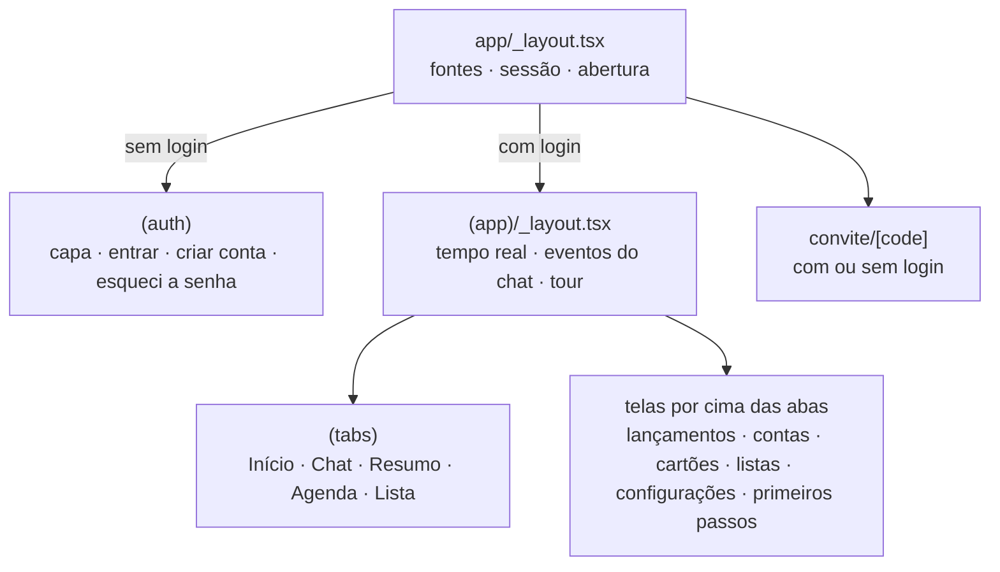
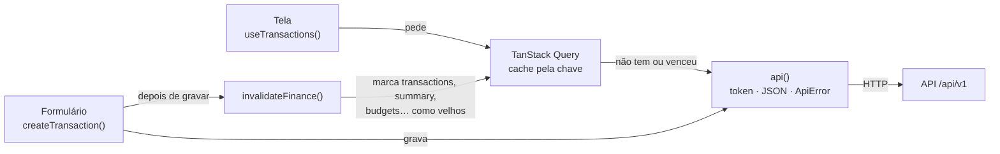

# 3. App

O app é um Expo (React Native) organizado em quatro camadas: as **telas** (`src/app`) mostram, a camada de **API** (`src/api`) busca e guarda os dados da API num cache, os **stores** (`src/stores`) guardam o pouco estado que não vem da API e a **lib** (`src/lib`) tem as regras puras e as conexões com a rede. A tela nunca chama a rede diretamente.

## Navegação: cada arquivo é uma tela

O Expo Router transforma os arquivos de `src/app` em rotas. `app/(app)/transactions/new.tsx` é a tela `/transactions/new`; `app/(app)/cards/[id]/index.tsx` é `/cards/12`, e o `12` chega na tela por `useLocalSearchParams`.

Cada pasta pode ter um `_layout.tsx`, que envolve as telas dela:

| Layout | O que faz |
|---|---|
| `app/_layout.tsx` (raiz) | Segura a splash do sistema (`SplashScreen.preventAutoHideAsync`), carrega as fontes, lê o login salvo (`useSession().restore`) e escolhe o grupo de telas: com `Stack.Protected`, sem login só existe `(auth)`; com login, só `(app)`. Quando a sessão muda (entrou, saiu, token recusado), o Expo Router troca de grupo sozinho. Monta também a folha de confirmação (`SheetHost`) e a abertura (`OpeningSplash`). |
| `app/(auth)/_layout.tsx` | As telas sem login, começando pela capa (`welcome`). |
| `app/(app)/_layout.tsx` | As telas com login. Abre a conexão ao vivo (`useRealtimeConnection`), liga os eventos do chat (`syncAssistantEvents`), registra como cada tela abre (formulários sobem de baixo como `modal`) e monta o tour (`TourOverlay`) por cima de tudo. |
| `app/(app)/(tabs)/_layout.tsx` | As 5 abas: Início, Chat, Resumo, Agenda e Lista, com o número de avisos não lidos na aba Chat. |

> **Para explicar:** "A estrutura de pastas é o mapa do app. Um arquivo vira uma tela, e o layout da raiz decide se a pessoa vê as telas de entrada ou o app, conforme haja login. Quando o login muda, a navegação muda sozinha."

## Como o app busca e guarda os dados

Toda conversa com a API passa por três peças:

1. **`api()`** (`src/lib/api.ts`) faz a chamada HTTP. Põe o token da sessão no cabeçalho, manda JSON (ou `FormData`, no caso da voz) e transforma qualquer falha num `ApiError` com a mensagem pronta para a tela. Um **401** com login encerra a sessão: limpa o cache e o token, e o layout da raiz leva a pessoa para a entrada.
2. **Um módulo por recurso** em `src/api/` (`transactions.ts`, `cards.ts`, `bills.ts`…) junta a chamada com o cache do TanStack Query. As leituras viram hooks (`useTransactions(filtros)`, `useSummary(mes)`); as gravações, funções (`createTransaction(dados)`). As opções de cada consulta ficam numa função própria (`transactionsQuery`, `summaryQuery`, `meQuery`), usada tanto pelo hook quanto pelo `prefetchHome`.
3. **O cache** (`src/lib/queryClient.ts`): cada resposta fica guardada pela sua chave (`src/api/keys.ts`, por exemplo `['transactions', filtros]`) e vale por 30 segundos. Erros de falta de conexão ou do servidor são tentados de novo duas vezes; erros de validação ou permissão, não. Ao voltar o app do segundo plano, as telas abertas buscam de novo (`focusManager`).

**Depois de gravar**, o app não tenta adivinhar o que mudou. `invalidateFinance()` (`src/api/keys.ts`) marca como velhos todos os dados que um lançamento pode afetar (lançamentos, resumo, orçamentos, faturas, contas, receitas fixas, lembretes e primeiros passos), pelo começo da chave. As telas abertas buscam de novo sozinhas. `closeAndRefresh()` (`src/lib/navigation.ts`) faz isso na ordem certa: fecha o formulário primeiro e só depois invalida, para a tela que fecha não buscar à toa.

**Na abertura**, `prefetchHome()` (`src/api/home.ts`) busca de uma vez o que o Início mostra (a pessoa, o resumo do mês, os lançamentos de hoje, os avisos não lidos e os primeiros passos). A abertura espera esses dados, com limite de 3 s, para a capa abrir sobre a tela completa.

> **Para explicar:** "A tela pede o dado a um cache, não à rede. Se o cache tem uma cópia recente, a tela aparece na hora; se não, ele busca. Quando alguém grava algo, o app marca os dados afetados como velhos, e as telas abertas atualizam sozinhas."

## O estado que não vem da API

O que é da API fica no cache do TanStack Query. O pouco que é só do app fica em stores do Zustand (`src/stores/`), cada um com um motivo:

| Store | Guarda | Por que não fica no cache |
|---|---|---|
| `session.ts` | O token e o status (`loading`, `signedIn`, `signedOut`). O token vai para o `SecureStore`, criptografado pelo sistema. | É a chave para todas as chamadas, e precisa existir antes delas. |
| `chatStream.ts` | Os pedaços da resposta do assistente que estão chegando ao vivo. | Muda várias vezes por segundo; quando a resposta termina, a mensagem pronta vai para o cache. |
| `actionDrafts.ts` | As edições feitas numa ficha do chat antes de confirmar. | A lista do chat recicla os componentes ao rolar; o que estivesse só dentro da ficha se perderia. |
| `confirm.ts` | A pergunta aberta na folha de confirmação (`await confirm({…})`). | É estado de interface, não dado. |
| `invite.ts` | O código de um convite aberto antes do login. | Precisa sobreviver à tela de entrar, só na memória. |
| `tour.ts` | Se o tour está aberto e em que passo. | Estado de interface; o ponto para retomar vai para a API. |

## Tempo real

O app recebe as respostas do assistente e os avisos ao vivo por WebSocket, do **Reverb** (o servidor do Laravel, que fala o protocolo Pusher).

- **Cliente próprio, sem biblioteca.** `src/lib/realtime.ts` (a conexão) e `src/lib/pusherProtocol.ts` (montar e ler as mensagens do protocolo, com testes) substituem o Laravel Echo e o pusher-js.
- **Uma conexão para o app inteiro**, aberta pelo `useRealtimeConnection` no layout `(app)` enquanto houver login.
- **Um canal privado por pessoa**, `private-user.{id}`. Para entrar nele, o app pede uma assinatura em `POST /api/v1/broadcasting/auth`, com o mesmo token da API; o backend só assina se o id for o da própria pessoa (`backend/routes/channels.php`).
- **A conexão se cuida sozinha:** responde aos pings do servidor, manda um a cada 25 s, reconecta em 1, 2, 5, 10 e depois a cada 15 s, e reconecta na hora quando o app volta do segundo plano.
- **Os eventos viram cache.** `syncAssistantEvents()` (`src/api/assistant.ts`) liga cada evento a uma ação: um pedaço de resposta vai para o `chatStream`; a resposta pronta, um card que mudou ou um aviso entram no cache da conversa.
- **O WebSocket é atalho, não a fonte da verdade.** Enquanto houver mensagem pendente, a conversa é buscada a cada 4 s (2 s sem conexão), e, quando a conexão volta, a conversa e os avisos são buscados de novo. Nada se perde se o WebSocket cair.

O caminho completo de uma mensagem, do microfone até a ficha, está no [diagrama de arquitetura](https://leo-o-nardo.github.io/caderneta/arquitetura.html) e será detalhado na etapa dos fluxos.

> **Para explicar:** "Para não ficar perguntando 'já respondeu?', o app deixa uma linha aberta com o servidor e recebe a resposta aos pedaços, enquanto ela é escrita. Mas tudo também fica salvo no banco: se a linha cair, o app busca de novo e não perde nada."

## Erros na tela

- `toApiError` (`src/lib/apiError.ts`) traduz cada resposta de erro numa mensagem em português: **422** usa a mensagem do primeiro campo; **401**, **403**, **404** e **429** têm frases do app; **5xx** vira "Algo deu errado do nosso lado"; sem rede, "Sem conexão com o servidor".
- Nos formulários, `ApiError.field('nome')` põe o erro embaixo do campo, e `messageOutside(campos)` mostra fora dos campos só o erro que não caberia em nenhum campo visível, para nenhum erro ficar escondido.
- Nas telas de leitura, o padrão é: carregando (`ActivityIndicator`), erro (a mensagem em Tijolo) ou os dados.

## Visual e regras puras

- **Tudo passa pelos tokens do guia.** `src/theme/tokens.ts` tem as cores (`colors.canvas` é o Papel, `colors.ink` a Tinta, `colors.accent` o Musgo…), os espaços, os cantos e as fontes. O componente `Text` (`src/components/ui/Text.tsx`) só aceita as variantes do guia (`title`, `subtitle`, `body`, `caption`…). `src/components/ui/` são os componentes do guia (`Button`, `BottomSheet`, `Form`, `Amount`…).
- **Regras sem tela ficam em `src/lib/`**, testadas com Jest (117 testes em 21 arquivos): dinheiro, datas, faturas, orçamentos, listas, o tour. Assim, uma regra como "em que fatura cai esta compra" ou "o que mostrar no aviso de contas" é testada sem abrir o app.
- **React Compiler ligado** (`app.json`, `experiments.reactCompiler`): o compilador memoriza componentes e funções sozinho, por isso o código quase não tem `useCallback` e `useMemo`.

## O que fica em outros documentos

- A abertura animada (`OpeningSplash`), as boas-vindas, os primeiros passos e o tour têm as regras visuais no [guia de design](https://leo-o-nardo.github.io/caderneta/design-guide.html) e entram na etapa dos fluxos.
- O assistente no app (fichas, confirmar, desfazer, voz) entra junto com o assistente do backend, na próxima etapa.
