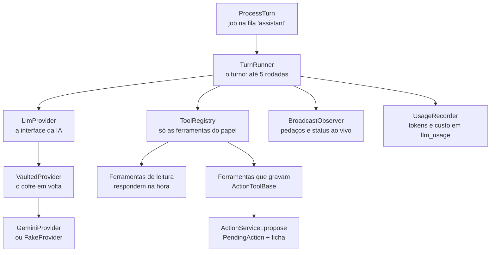

# 4. O assistente

O assistente é o maior subsistema do backend (`backend/app/Assistant/`, 61 arquivos). Ele recebe uma frase ("gastei 42 no almoço"), conversa com um modelo de IA que pode pedir **ferramentas** (consultar gastos, preparar um lançamento), e devolve um texto com **fichas** (cards) para a pessoa conferir. A regra que organiza tudo: **a IA propõe, quem grava é o app**. O que exige conferência vira uma ação pendente, e o "Confirmar" grava sem passar pela IA.

## As peças e como se ligam

| Peça | Onde | O que faz |
|---|---|---|
| `ProcessTurn` | `app/Jobs/` | Roda o turno fora da requisição, na fila `assistant`, uma vez só (`tries = 1`). |
| `TurnRunner` | `app/Assistant/` | O turno: monta o pedido, conversa com a IA, roda as ferramentas, salva a resposta. |
| `AssistantContext` e `AssistantPrompt` | `app/Assistant/` | O que a IA precisa saber: hoje no fuso da pessoa, com quem fala, os nomes que a casa usa (categorias, cartões, listas, contas, receitas, orçamentos) e as instruções fixas. |
| `LlmProvider` | `app/Assistant/Llm/` | O contrato de uma IA: `generate($pedido, $aoChegarPedaco)`. O resto do assistente só conhece isto. |
| `GeminiProvider` e `FakeProvider` | `app/Assistant/Llm/` | A IA real (Gemini) e a simulada, por regras, para desenvolvimento e testes. |
| `VaultedProvider`, `SecureDataVault`, `DeltaUnmasker` | `app/Assistant/Privacy/` | O cofre de privacidade. |
| `ToolRegistry` e as 19 ferramentas | `app/Assistant/Tools/` | O que a IA pode pedir. |
| `ActionService`, `ActionToolBase` | `app/Assistant/Actions/` | O ciclo das ações: propor, confirmar, cancelar, desfazer. |
| `TurnObserver` e `BroadcastObserver` | `app/Assistant/`, `Observers/` | Quem acompanha o turno: manda ao vivo para o app (ou, no terminal, o `ConsoleObserver`). |
| `Transcriber`, `GeminiTranscriber` | `app/Assistant/Voice/` | A voz vira texto antes do turno. |
| `UsageRecorder` | `app/Assistant/` | Grava o que cada chamada à IA gastou. |

## Um turno, passo a passo

`TurnRunner::run` recebe a resposta vazia (`status = pending`), criada pelo `ConversationController` junto com a pergunta.

1. **Contexto.** Confere se a pessoa ainda é da casa (`roleIn`) e preenche o `HouseholdContext` com a casa, o papel e a pessoa: fora de uma requisição, ninguém mais faria isso, e os filtros de casa e de privados precisam dele.
2. **O que a IA vai ler.** `AssistantPrompt::system` junta as instruções fixas com o contexto do dia. `history()` pega as **12 últimas mensagens** prontas da conversa. Os avisos do app entram como `[aviso do app] Luz vence amanhã`, para a IA entender o "paguei" seguinte. As fichas de respostas anteriores ganham uma nota do que aconteceu com elas (`[ação: transactions_confirm confirmada e gravada]`), porque a confirmação passou pelo app e a IA não saberia.
3. **As ferramentas permitidas.** `ToolRegistry::availableFor($papel)`: quem é "Só leitura" recebe só as de consulta. A IA nem fica sabendo que as outras existem.
4. **As rodadas** (até `max_rounds`, 5). Em cada uma, `LlmProvider::generate` devolve **ou** o texto final **ou** pedidos de ferramenta.
   - O texto chega aos pedaços e vai para o app na hora (`$observer->delta`).
   - Para cada ferramenta pedida, o app recebe um status ("Consultando lançamentos…"), a ferramenta roda (`runTool`) e o resultado volta para a IA na rodada seguinte.
   - Uma ferramenta que quebra não derruba a resposta: `runTool` captura o erro e devolve `ToolResult::error`, e a IA avisa a pessoa.
5. **Fim.** A resposta é salva com o texto, as fichas (`metadata.cards`) e o rastro das ferramentas chamadas (`metadata.tools`, útil para entender o que a IA fez), e o app recebe `assistant.completed`.

**Quando algo falha:**

- A IA ocupada ou fora do ar (`LlmException`) vira uma mensagem amigável na própria resposta (`status = failed`), e o app recebe `assistant.failed`.
- Se uma ficha **já tinha sido preparada** nesse turno, a resposta é salva com a ficha e um aviso, em vez de perder a ação pendente (que ficaria sem onde ser confirmada).
- Se o worker mata o job por tempo (120 s), `ProcessTurn::failed` marca a resposta como falha, para ela não ficar "pensando" para sempre.

> **Para explicar:** "O assistente funciona em rodadas. A IA lê a conversa e decide: ou responde, ou pede uma ferramenta, como 'busque os gastos de outubro'. O sistema roda a ferramenta e devolve o resultado, e a IA continua. Ela nunca acessa o banco: só pede, e o código da casa decide o que entrega."

## As ferramentas e os níveis de cuidado

Cada ferramenta declara um nível (`ToolTier`), que decide o que acontece quando a IA a pede:

| Nível | Ferramentas | O que acontece |
|---|---|---|
| `Read`: só consulta | `QueryTransactions`, `GetMonthOverview`, `GetCardInvoice`, `ListBills`, `GetBudgetStatus`, `GetList`, `ListReminders` | Responde na hora; o resultado volta para a IA. Qualquer papel usa. |
| `Confirm`: conferir antes | `CreateTransactions`, `UpdateTransaction`, `MarkBillPaid` | Vira uma ficha editável, pendente por 30 minutos. Nada é gravado antes do "Confirmar". |
| `Explicit`: impacto em destaque | `DeleteTransaction`, `DeleteList` | Ficha que mostra o que muda nos números ("Sai R$ 42,00 dos gastos de outubro.", e se uma conta paga volta a ficar em aberto), também pendente. |
| `Immediate`: grava e deixa desfazer | `AddListItems`, `CheckListItems`, `CreateList`, `CreateReminder`, `CreateRecurringBill`, `CreateRecurringIncome`, `SetBudget` | Grava na hora, com "Desfazer" por 2 minutos. |

As ferramentas validam os argumentos da IA antes de rodar (`Tool::handle`, com o `Validator` do Laravel). Uma data malformada não quebra nada: volta como erro para a IA corrigir ou perguntar.

Os valores que as ferramentas devolvem já vêm escritos (`Money::format`, "R$ 1.234,56"), para a IA só copiar e nunca fazer conta nem arredondar por conta própria.

## As ações: propor, confirmar, desfazer

Uma ferramenta que grava (`ActionToolBase`) passa por três momentos:

1. **Preparar** (`prepare`): completa o que a IA mandou, sem gravar nada. Acha a categoria pelo nome, o cartão (o citado; sem nome, o padrão de quem fala ou o único da casa; sem como decidir, devolve a pergunta para a IA fazer) e a data de hoje.
2. **Validar** (`validatePayload`): confere os dados **com as mesmas regras do formulário do app** (`RequestRules`). Roda ao propor e de novo ao confirmar, com o que a pessoa editou na ficha.
3. **Propor** (`ActionService::propose`): grava uma `PendingAction` (a ferramenta, o nível, os dados, quem pediu, a mensagem onde a ficha aparece) e devolve a ficha. Nas imediatas, executa na mesma transação.

Depois, o que a pessoa toca no app chega por rotas próprias (`POST /actions/{id}/confirm`, `/cancel`, `/undo`), tratadas pelo `ActionService`:

- **Só quem pediu** mexe na ação (`resolve`); para outra pessoa, ela não existe (**404**). O papel é conferido de novo: quem virou "Só leitura" depois não grava (**403**).
- A ação roda **na casa onde foi criada**, mesmo que a pessoa tenha trocado de casa no meio.
- **Dois toques, uma gravação:** a linha da ação é travada (`lockForUpdate`) e o status é conferido antes de gravar.
- Pendente há mais de 30 minutos, a ação **expira** e a ficha mostra isso.
- A ficha atualizada vai para a resposta da requisição e, pelo evento `action.updated`, para os outros aparelhos da pessoa.

> **Para explicar:** "Quando a IA quer lançar um gasto, ela não lança: o sistema monta uma ficha com os dados conferidos e guarda como 'esperando'. A pessoa pode corrigir o valor ou a categoria e tocar em Confirmar. Aí o app grava exatamente o que está na ficha, com as mesmas regras do formulário. A IA não tem uma segunda chance de inventar um número."

## A IA por trás de uma interface

**Strategy.** O `AppServiceProvider` decide qual classe implementa `LlmProvider` pelo `.env`: `ASSISTANT_PROVIDER=gemini` usa o `GeminiProvider`; `fake` (o padrão) usa o `FakeProvider`, que entende frases por regras (`FakeIntents`, `FakeReplies`) e manda a resposta palavra por palavra, como o streaming de verdade. Trocar de IA é trocar uma classe; o `TurnRunner` não muda.

**`GeminiProvider`** (`app/Assistant/Llm/GeminiProvider.php`):

- Chama o `streamGenerateContent` do Gemini por SSE (eventos que chegam aos pedaços), com o cliente HTTP do Laravel, sem SDK. O modelo padrão é o `gemini-3.5-flash-lite` (`config/assistant.php`).
- A chave vai no cabeçalho `x-goog-api-key`, nunca na URL (URLs aparecem em logs).
- Cada rodada manda a conversa inteira: nada fica guardado do lado do Google entre as rodadas.
- `GeminiStream` junta os pedaços: o texto vai para a tela na hora; os pedidos de ferramenta, a assinatura de raciocínio de cada um e os tokens gastos ficam para o fim.
- **Tenta de novo uma vez**, só se a falha for passageira (429 ou 5xx) **e** nada tiver ido para a tela ainda. Um 400, 403 ou 404 (chave, modelo ou pedido errado) não é repetido.

## O cofre de privacidade

**Decorator.** O `VaultedProvider` implementa a mesma interface `LlmProvider` e envolve qualquer outro provedor: o `TurnRunner` acha que fala com a IA, e a IA nunca vê os dados sensíveis.

- **Na ida**, `SecureDataVault::mask` troca por marcadores tudo que vai para a IA (instruções, conversa, resultados das ferramentas): CPF e CNPJ (pelos dígitos verificadores), cartões (pelo algoritmo de Luhn), telefones, e-mails, chaves Pix, agência e conta. Fica `[CPF_1]`, `[CARTAO_1]`.
- O mesmo valor ganha sempre o mesmo marcador, mesmo escrito de outro jeito ("529.982.247-25" e "52998224725").
- **Na volta**, o texto, os pedaços ao vivo e os argumentos das ferramentas chegam com os valores reais. O `DeltaUnmasker` segura um pedaço que pode ser o começo de um marcador ("[CP") até ele completar, para a tela nunca mostrar `[CPF_1]`.
- Os pedidos de ferramenta voltam para a IA **exatamente como ela mandou**, ainda mascarados (`originalCalls`): a assinatura de raciocínio que o Gemini 3 exige deixaria de valer se o texto mudasse.
- Nomes de pessoas não são trocados: a IA precisa deles ("no cartão da Ana").
- O cofre vem ligado por padrão (`ASSISTANT_VAULT=true`) e tem testes próprios (`tests/Unit/SecureDataVaultTest.php`, `tests/Feature/Assistant/VaultTest.php`).

## A voz

A mensagem de voz é transformada em texto **antes** do turno, e depois segue como se tivesse sido digitada.

1. `ConversationController::voice` grava o áudio em `storage/app/private/voice` (fora de qualquer URL pública), cria a pergunta (`transcribing`) e a resposta (`pending`) numa transação e encadeia dois jobs: `Bus::chain([TranscribeVoice, ProcessTurn])`.
2. `TranscribeVoice` manda o áudio ao `Transcriber`. O `GeminiTranscriber` usa o `generateContent` sem streaming (a resposta é curta), com o raciocínio no mínimo e uma dica dos nomes da casa, para escrever certo "Nubank", "iFood" e o nome das listas.
3. **O áudio é apagado no `finally`**, dê certo ou não. Uma rotina de hora em hora (`voice:prune`, em `routes/console.php`) apaga qualquer áudio esquecido há mais de uma hora.
4. Com o texto, a pergunta fica `completed` e o app recebe `message.transcribed`. Sem fala, ou com o serviço fora, a pergunta e a resposta ficam como falha, com uma explicação, e o `ProcessTurn` seguinte vê a resposta já resolvida e não faz nada.

O texto transcrito passa pelo cofre como qualquer outro antes de chegar ao assistente. O **áudio** vai para a transcrição sem o cofre, que só sabe mascarar texto.

## Custos e limites

- **`UsageRecorder`** grava cada chamada em `llm_usage`: a rodada, o propósito (`chat` ou `transcription`), os tokens, o tempo e o custo estimado pelos preços de `config/assistant.php`. A IA e o transcritor simulados não entram. Falhar ao gravar nunca derruba a resposta.
- `php artisan assistant:usage` mostra o uso e o custo dos últimos dias.
- **Limites:** 150 mensagens por pessoa por dia, contadas no fuso dela e somando todas as casas (`ConversationController::ensureUnderDailyLimit`); 30 por minuto (`throttle:assistant`); 2.000 caracteres por mensagem.

## No app

| O que | Onde |
|---|---|
| Mandar texto ou voz | `sendMessage` e `sendVoice` (`src/api/assistant.ts`). A API responde 202 com a pergunta e a resposta "pensando", que entram na conversa logo em seguida. |
| A conversa | `useConversation`: 30 mensagens por vez, buscando sozinha enquanto algo está pendente. |
| A resposta chegando | `syncAssistantEvents` põe os pedaços no `chatStream`; a resposta pronta substitui a mensagem no cache. |
| As fichas | `ChatCardView` (`src/components/cards/`) escolhe o componente pelo `type` do card: `transactions_confirm`, `transaction_update`, `bill_confirm`, `delete_confirm`, `bar_chart`, os de aviso… |
| Os botões | `useCardAction` controla carregando e erro; `confirmAction(id, edicoes)`, `cancelAction` e `undoAction` chamam a API. As edições ficam no `actionDrafts` até confirmar. |
| Depois de gravar | `applyActionResponse` troca a ficha no lugar e atualiza as outras telas (Início, Resumo, Agenda, Lista). |
| Reportar uma resposta | A bandeirinha depois da hora de cada resposta (`ReportButton`, em `MessageItem`) confirma na folha e chama `reportMessage`. A API (`ConversationController::report`) marca `reported_at` no `metadata` e manda a resposta e a pergunta de antes para o administrador (`ResponseReported`). O Google Play exige isso em apps com IA que gera texto. |

## Para testar sem o app

| Comando | Para quê |
|---|---|
| `php artisan assistant:ask` | Faz uma pergunta e mostra a resposta no terminal (com o `ConsoleObserver`). |
| `php artisan assistant:action` | Confirma, cancela ou desfaz uma ação, como os botões da ficha. |
| `php artisan assistant:voice` | Manda um arquivo de áudio pelo mesmo caminho da mensagem de voz. |
| `php artisan assistant:usage` | O uso e o custo estimado da IA. |

Os testes do backend rodam sempre com a IA e o transcritor simulados (`phpunit.xml`), e o Gemini é testado com respostas falsas do `Http::fake` (`tests/Feature/Assistant/GeminiProviderTest.php`). Nenhum teste gasta a chave.
