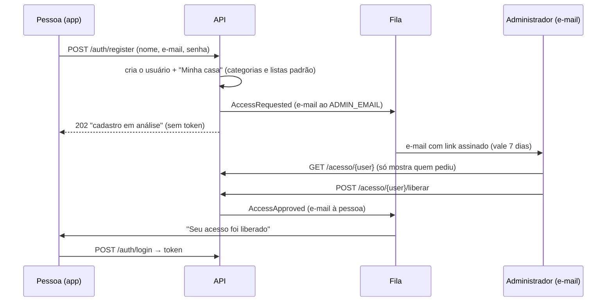
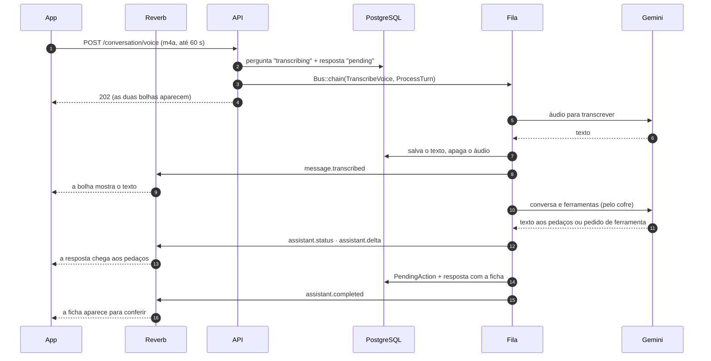
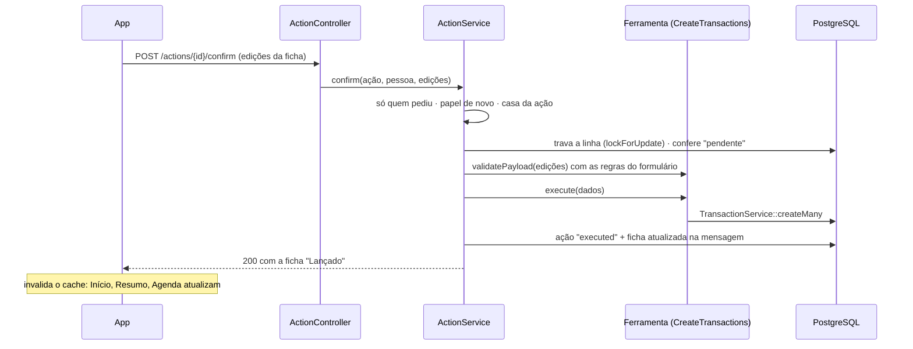
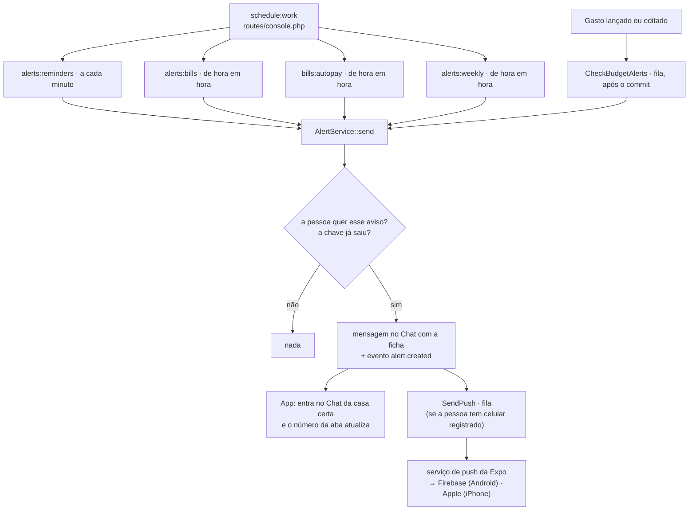

# 5. Os fluxos, passo a passo

Cada fluxo segue o caminho real pelo código: o que o inicia, quem participa, em que ordem, como os dados são validados e gravados, como o resultado chega à pessoa e o que acontece quando algo dá errado. Os detalhes das peças estão nos documentos anteriores ([backend](02-backend.md), [app](03-app.md), [assistente](04-assistente.md)); aqui o foco é a ordem dos acontecimentos.

| # | Fluxo | Começa com |
|---|---|---|
| 1 | [Cadastro e liberação](#1-cadastro-e-liberação) | "Criar conta" na capa |
| 2 | [Entrar e abrir o app](#2-entrar-e-abrir-o-app) | "Entrar", ou abrir o app já com login |
| 3 | [Esqueci a senha](#3-esqueci-a-senha) | "Esqueci a senha" |
| 4 | [Convite](#4-convite) | O dono convida alguém |
| 5 | [Lançar pelo formulário](#5-lançar-pelo-formulário) | "ou lançar manualmente" |
| 6 | [Mensagem de voz até a ficha](#6-mensagem-de-voz-até-a-ficha) | O microfone do Início |
| 7 | [Confirmar, cancelar ou desfazer uma ficha](#7-confirmar-cancelar-ou-desfazer-uma-ficha) | Um botão da ficha |
| 8 | [Avisos agendados](#8-avisos-agendados) | O relógio (`schedule:work`) ou um gasto lançado |
| 9 | [Receitas fixas e débito automático](#9-receitas-fixas-e-débito-automático) | O relógio, de hora em hora |
| 10 | [Abertura e primeiro acesso](#10-abertura-e-primeiro-acesso) | Abrir o app |
| 11 | [Excluir a conta](#11-excluir-a-conta) | Configurações › Conta, ou a página `/excluir-conta` |

## 1. Cadastro e liberação

Qualquer pessoa pode se cadastrar, mas só entra depois que o administrador libera. Quem chega por convite entra direto.

1. **No app**, criar conta é uma conversa em dois passos (`src/app/(auth)/register.tsx`): primeiro o nome, depois o e-mail e a senha. A senha precisa de 8 caracteres, letras e números (`Password::defaults` no backend, `passwordChecks` no app, com as marcas na tela).
2. **`AuthController::register`** cria o usuário e, numa transação, a casa padrão (`HouseholdService::createDefaultFor`, com `DefaultCategories` e `DefaultLists`).
3. **Sem convite:** `AccessService::request` avisa o administrador e a resposta é **202**, sem token. O app mostra "Cadastro recebido".
4. **O e-mail do administrador** traz um link assinado (`URL::signedRoute`, 7 dias, `config/access.php`) para a página `acesso/{user}` (`routes/web.php`, `AccessApprovalController`).
5. **Abrir o link não decide nada.** Só os botões da página (POST, também assinados) liberam ou recusam. Os filtros de e-mail e os antivírus abrem os links para conferir, e um link que liberasse direto liberaria sem ninguém clicar.
6. **`AccessService::approve`** grava `approved_at` e manda o e-mail de liberação. **`reject`** grava `rejected_at`, derruba todos os tokens da pessoa e manda um aviso educado; dá para liberar depois.
7. **Com convite válido**, a conta entra liberada (`joinedByInvite`), na casa do convite, e recebe o token na hora (**201**). O administrador só é avisado.

**Erros:** e-mail já usado, senha fraca ou convite inválido voltam como **422** por campo. Link vencido ou alterado mostra a página "Link vencido" (`access.expired`), em vez do 403 do Laravel. Se o administrador decidir de novo, nada muda (`approve` e `reject` não repetem).

**Linha de comando:** `users:pending`, `users:approve` e `users:reject` fazem o mesmo sem o e-mail.

## 2. Entrar e abrir o app

1. **Entrar** (`src/app/(auth)/login.tsx`) chama `login()` (`src/api/auth.ts`), que manda o e-mail, a senha e o nome do aparelho (`Device.deviceName`, que vira o nome do token).
2. **`AuthController::login`**: senha errada é **422** em `email`; senha certa com a conta em análise ou recusada é **422** em `access_pending` ou `access_rejected`, e o app mostra um aviso em Atenção ou em Tijolo, em vez de um erro comum.
3. **Deu certo:** a API devolve o token e o usuário. `startSession` limpa o cache (de outra conta que estivesse no aparelho), já guarda o usuário no cache (sem precisar chamar `/me`) e grava o token no `SecureStore` (`useSession().signIn`).
4. **O layout da raiz** vê o status mudar para `signedIn` e troca as telas de entrada pelas abas (`Stack.Protected`).
5. **Nas próximas aberturas**, `useSession().restore` lê o token salvo, e o app já abre logado (veja o [fluxo 10](#10-abertura-e-primeiro-acesso)).

**Sair:** `signOut` apaga o token na API (`/auth/logout`), limpa o cache e o `SecureStore`. **Token recusado** em qualquer chamada (401): `api()` faz o mesmo sozinho, e a pessoa volta para a capa.

## 3. Esqueci a senha

1. `POST /auth/forgot-password` com o e-mail. `PasswordResetService::sendCode` gera um código de 6 números, guarda **só o hash** dele e manda por e-mail (no assunto também). A resposta é a mesma exista ou não a conta, para não revelar quem tem cadastro.
2. `POST /auth/reset-password` com o e-mail, o código e a senha nova. O código vale **15 minutos** e aceita **5 tentativas erradas**; depois disso, é apagado e precisa pedir outro.
3. Deu certo: a senha muda e **todos os tokens da pessoa são apagados**, então qualquer aparelho com a senha antiga sai. O app leva para entrar de novo.

## 4. Convite

1. **O dono convida** em Configurações › Membros e convites, escolhendo o papel (membro ou só leitura). `InvitationService::create` gera um código de 6 caracteres sem letras e números que se confundem (sem 0, O, 1 e I), válido por 7 dias, com no máximo 10 convites abertos por casa. Só o dono pode (`HouseholdPolicy::manageMembers`).
2. **O app compartilha** pelo menu do sistema (WhatsApp, por exemplo) uma mensagem com o código escrito, sem link (`inviteMessage`, `src/lib/households.ts`). O link que a API monta (`url`, de `INVITE_URL`) fica de fora para o endereço do servidor não aparecer na conversa; o código funciona em qualquer caso.
3. **Quem recebe, com login:** a tela `convite/[code]` mostra a casa e o papel (`GET /invitations/{code}`) e aceita com `POST /invitations/{code}/accept`.
4. **Quem recebe, sem login:** a mesma tela, numa versão de capa. "Criar conta" leva o código junto (cadastro por convite, liberado na hora). "Já tenho conta" guarda o código no store `invite` e, depois do login, o Início abre o convite de novo.
5. **`InvitationService::accept`** trava a linha do convite (dois aceites ao mesmo tempo rodam um depois do outro), confere se ele ainda vale e se a pessoa já não é da casa, adiciona a pessoa com o papel do convite e troca a casa atual dela para essa.
6. **No app**, trocar de casa zera o cache inteiro (`resetAfterHouseholdChange`): tudo que estava guardado era da casa anterior.

**Limite atual:** não há link que abra o app direto no convite; quem recebe digita o código de 6 caracteres.

## 5. Lançar pelo formulário

O caminho na API está detalhado em [O caminho de uma requisição](02-backend.md#o-caminho-de-uma-requisição). Do lado do app:

1. `src/app/(app)/transactions/new.tsx` abre o `TransactionForm`: valor, descrição, categoria (a grade das 7 primeiras e "Todas"), data, forma de pagamento, cartão e "Só meu".
2. "Lançar" chama `createTransaction(dados)` (`src/api/transactions.ts`).
3. **Erro de validação:** cada mensagem aparece embaixo do campo dela (`ApiError.field`); o que não é de nenhum campo visível aparece acima do botão.
4. **Deu certo:** `closeAndRefresh()` fecha o formulário e chama `invalidateFinance()`. O Início, o Resumo, as faturas e os primeiros passos buscam de novo.
5. **Depois do commit**, `CheckBudgetAlerts` roda na fila. Se a categoria passou de 80% ou de 100% do orçamento, todos da casa recebem um aviso no Chat (veja o [fluxo 8](#8-avisos-agendados)).

**Variações:** no crédito, a compra ganha a fatura pelo dia de fechamento do cartão; uma compra parcelada passa pelo `InstallmentService` (todas as parcelas, nas faturas certas); "Repetir todo mês" numa receita cria também a receita fixa.

## 6. Mensagem de voz até a ficha

O fluxo mais completo do sistema: passa pelo app, pela API, pela fila, pelo cofre, pela IA e pelo WebSocket. O desenho no estilo do guia está na [página de arquitetura](https://leo-o-nardo.github.io/caderneta/arquitetura.html).

1. **App.** O microfone do Início grava (`useVoiceRecorder`, `src/lib/useVoiceRecorder.ts`) em m4a mono, 16 kHz; aos 60 s, para e envia sozinho. `sendVoice` manda o arquivo como `FormData`, embrulhado no `File` do `expo-file-system` (o `fetch` do Expo recusa o formato antigo `{ uri, name, type }` do React Native), e, com a resposta, o app vai para o Chat.
2. **API.** `ConversationController::voice` confere o limite do dia, valida o arquivo (`SendVoiceRequest`: tipo, até 2 MB, entre 0,5 e 60 s), grava o áudio fora da pasta pública, cria as duas mensagens numa transação e encadeia os jobs. Responde **202**.
3. **Transcrição** (`TranscribeVoice`): o áudio vai ao `GeminiTranscriber`, com os nomes da casa como dica. O áudio é apagado no `finally`. O texto vira o conteúdo da pergunta, e o app recebe `message.transcribed`.
4. **Turno** (`ProcessTurn` → `TurnRunner`): o texto é tratado como se tivesse sido digitado, passando pelo cofre. A IA pede, por exemplo, `CreateTransactions` com "almoço, 42, débito".
5. **Ação.** A ferramenta prepara (acha a categoria Alimentação, a data de hoje), valida com as regras do formulário e o `ActionService::propose` grava uma `PendingAction`, que vale 30 minutos.
6. **Ao vivo.** Os pedaços de texto saem em `assistant.delta` (juntados a cada ~100 ms, com número de sequência); no fim, `assistant.completed` traz a resposta com a ficha.

**Erros:** sem fala ou com a transcrição fora do ar, a pergunta mostra "Não entendi o áudio" e a resposta explica o que fazer. A IA ocupada vira uma resposta de falha amigável. Sem WebSocket, o app busca a conversa a cada 2 s até a resposta ficar pronta. Uma mensagem digitada segue os passos 4 a 6, com `POST /conversation/messages` e só o `ProcessTurn`.

## 7. Confirmar, cancelar ou desfazer uma ficha

1. A pessoa pode editar a ficha antes (valor, categoria, data, cartão). As edições ficam no store `actionDrafts`, porque a lista do chat recicla os componentes ao rolar.
2. **"Confirmar"** chama `confirmAction(id, edicoes)`. A IA não participa. O `ActionService` confere quem pede (outra pessoa recebe **404**), o papel (só leitura recebe **403**) e o prazo (mais de 30 minutos: "expirada"), trava a linha e confere o status, valida as edições com as mesmas regras do formulário e grava. Explícitas (apagar) não aceitam edição: vale o que foi mostrado.
3. **A ficha atualizada** volta na resposta e entra no lugar (`applyActionResponse`). Pelo evento `action.updated`, ela muda também nos outros aparelhos da pessoa.
4. **Na próxima pergunta**, a IA fica sabendo o que aconteceu, pela nota `[ação: … confirmada e gravada]` no histórico.
5. **"Cancelar"** só muda o status. **"Desfazer"** vale para as imediatas (itens de lista, lembretes, conta fixa, receita fixa, orçamento), por 2 minutos: a ferramenta desfaz o que gravou, com o que o `execute` devolveu.

**Erros:** dois toques rápidos gravam uma vez só (a segunda vê a ação já executada e recebe a mensagem de status). Uma edição inválida volta como **422** no campo da ficha.

## 8. Avisos agendados

Todos os avisos do app chegam no Chat, como mensagens do sistema com uma ficha, e nos celulares da pessoa, como notificação, por um caminho único: `AlertService::send`.

1. **Quem dispara:**
   - `alerts:reminders`, a cada minuto: os lembretes que chegaram na hora. O pessoal avisa só quem criou; o da casa, todos.
   - `alerts:bills`, de hora em hora: a conta que vence amanhã ou que vence hoje e segue em aberto, a partir das 9h no fuso de cada pessoa.
   - `alerts:weekly`, de hora em hora: o resumo da semana, no domingo a partir das 19h no fuso de cada pessoa, com os números de cada uma.
   - `CheckBudgetAlerts`, depois de cada gasto: 80% e 100% do orçamento.
   - `bills:autopay`, no [fluxo 9](#9-receitas-fixas-e-débito-automático).
2. **`AlertService::send`:**
   - confere se a pessoa quer aquele tipo de aviso (Configurações › Avisos, `users.alert_settings`);
   - grava a chave do aviso com `insertOrIgnore`;
   - cria a mensagem no Chat da casa certa e dispara `AlertCreated`;
   - se a pessoa tem algum celular registrado (`push_tokens`), põe o `SendPush` na fila.
   
   A chave diz exatamente o que o aviso é: `bill:12:2026-10:eve` é a véspera da conta 12 em outubro. Com chave única por pessoa, rodar a rotina de novo nunca manda o mesmo aviso duas vezes. Além disso, `withoutOverlapping` impede duas rodadas da mesma rotina ao mesmo tempo.
3. **Quem recebe:** avisos de conta vão só para quem pode lançar (dono e membros). Os números de cada pessoa são calculados com os filtros dela (`HouseholdContext::runAs`), então ninguém vê o gasto privado do outro num aviso.
4. **No app**, o aviso entra no Chat se for da casa aberta, e a aba Chat mostra quantos chegaram desde a última vez que ela foi aberta (`GET /alerts/unread`; abrir o Chat chama `/alerts/seen`).
5. **Os botões do aviso** ("Feito", "Adiar 1 h", "Amanhã", "Paguei", "Desfazer") chamam `POST /alerts/{message}/{action}` (`AlertActions`), que faz a ação e guarda o resultado na própria ficha ("Feito", "Adiado para 15:00").
6. **A notificação:**
   - **Registro:** o app pede a permissão numa folha do Início, uma vez por aparelho, depois das boas-vindas (`PushPrompt`), ou em Configurações › Avisos. Com ela dada, manda o endereço do aparelho a cada abertura (`POST /push-tokens`, `src/lib/push.ts`). O endereço fica ligado ao login (`personal_access_token_id`): sair da conta apaga o login e, em cascata, o aparelho. O mesmo celular nunca fica com duas pessoas.
   - **Envio:** `SendPush` monta a notificação com um título por tipo ("Lembrete", "Conta vencendo"), o texto do aviso (até 180 caracteres) e, por dentro, a casa e a mensagem. `ExpoPush` manda em lotes de até 100 para o serviço da Expo e apaga o aparelho que volta como `DeviceNotRegistered` (app desinstalado). Se o serviço falhar, a fila tenta de novo (3 vezes, com 30 s e 2 min de espera).
   - **No app:** com ele aberto, a notificação não aparece por cima: o aviso já chega no Chat ao vivo. Tocar numa notificação abre o Chat da casa do aviso, trocando de casa se precisar (`usePushNotifications`).
   - **Teste:** `php artisan alerts:test-push email` manda uma notificação de teste, sem passar pelo Chat.

**Erros:** sem o Reverb, o aviso continua salvo, e o app o vê na próxima vez que buscar a conversa. Sem o serviço de push, o aviso também continua no Chat; só a notificação atrasa ou não chega. O resumo da semana não sai numa semana sem nada a dizer.

## 9. Receitas fixas e débito automático

- **`incomes:launch`**, de hora em hora: para cada receita fixa, `RecurringIncomeService::launchDue` lança os meses que já chegaram e ainda não foram lançados, cada um no seu dia (o dia 31 vira o último dia nos meses curtos). A regra guarda até que mês já lançou (`launched_through`): isso impede lançar duas vezes e também impede que um lançamento apagado de propósito volte. Se a rotina ficou parada, ela alcança os meses que ficaram para trás.
- **`bills:autopay`**, de hora em hora: no dia do vencimento, a conta em débito automático é lançada sozinha (no débito), e todos que podem lançar recebem um aviso com "Desfazer". Se o valor muda todo mês, não dá para lançar sem saber quanto: o aviso pede o valor. Desfazer apaga a despesa, o mês volta a ficar em aberto, e ele não é lançado de novo (`autopay_through`).

## 10. Abertura e primeiro acesso

1. **O sistema mostra a splash nativa** (o ícone no Papel). `app/_layout.tsx` a segura (`preventAutoHideAsync`) enquanto carrega as fontes e lê o token.
2. **`OpeningSplash`** desenha exatamente a mesma imagem, solta a splash nativa e faz o ícone crescer até virar a capa da caderneta.
3. **Com login**, `useHomeReady` busca os dados do Início (`prefetchHome`). A capa espera parada por esses dados, no máximo 3 s depois de crescer, e então o elástico sai e a capa gira, revelando o Início completo. Um toque pula; com "Reduzir movimento", vira um fade.
4. **Na primeira entrada em cada casa** (`onboarding.welcome_seen` falso, em `household_user.onboarding`), o Início abre as **boas-vindas**: três telas, ou duas para quem entrou por convite, que terminam em "Configurar o essencial", "Conhecer o app" ou "Explorar sozinho".
5. **Os primeiros passos** (`GET /onboarding`) são calculados dos cadastros de verdade pelo `OnboardingService`: ter um cartão, uma receita fixa, uma conta fixa… Só o que não dá para calcular fica guardado, como os passos ignorados e as categorias conferidas.
6. **O tour** (`TourOverlay`) destaca os elementos de verdade (`TourTarget`): mede cada um, escurece a tela em volta e explica numa ficha. Ele troca de aba sozinho, salva o passo (`tour_step`) para retomar e pula o que não está na tela.

As regras visuais de cada parte estão no [guia de design](https://leo-o-nardo.github.io/caderneta/design-guide.html), nas versões 1.6 (abertura) e 1.7 (primeiro acesso).

## 11. Excluir a conta

As lojas exigem dois caminhos: pelo app e por um endereço na web, para quem já desinstalou.

1. **Pelo app,** a tela Configurações › Conta › Excluir conta (`settings/delete-account.tsx`) pede a senha e confirma na folha. Ela chama `DELETE /me` (`AuthController::destroyMe`); a senha é conferida pelo `DeleteAccountRequest`. Com a resposta, `deleteAccount` limpa o cache e a sessão, e o app volta para a capa.
2. **Pela web,** a página `/excluir-conta` (`AccountDeletionController`) pede o e-mail e a senha. Para e-mail desconhecido e senha errada, a mensagem é a mesma: a página não revela quem tem conta. Ela tem o mesmo limite de tentativas da entrada (`throttle:auth`).
3. **As casas primeiro** (`HouseholdService::removeEverywhere`), uma por vez e com a casa travada, como nas outras mudanças de membros. Onde a pessoa é a única dona, a casa passa para o membro mais antigo que pode editar. Sem ninguém assim, a casa é apagada, e quem era "Só leitura" ganha outra casa atual (`ensureCurrent`). Nas outras casas, a pessoa só sai.
4. **Depois, a conta** (`AccountService::delete`): os logins do Sanctum saem à mão, porque não têm chave estrangeira, e com eles os celulares do push. O código de senha pendente também sai. O resto vai em cascata com o usuário: conversas, ações pendentes, avisos, lembretes, cartões e convites mandados. Os lançamentos, as contas e as listas ficam na casa, só sem o `created_by`. Um áudio que ainda esperava a transcrição é apagado do disco.
