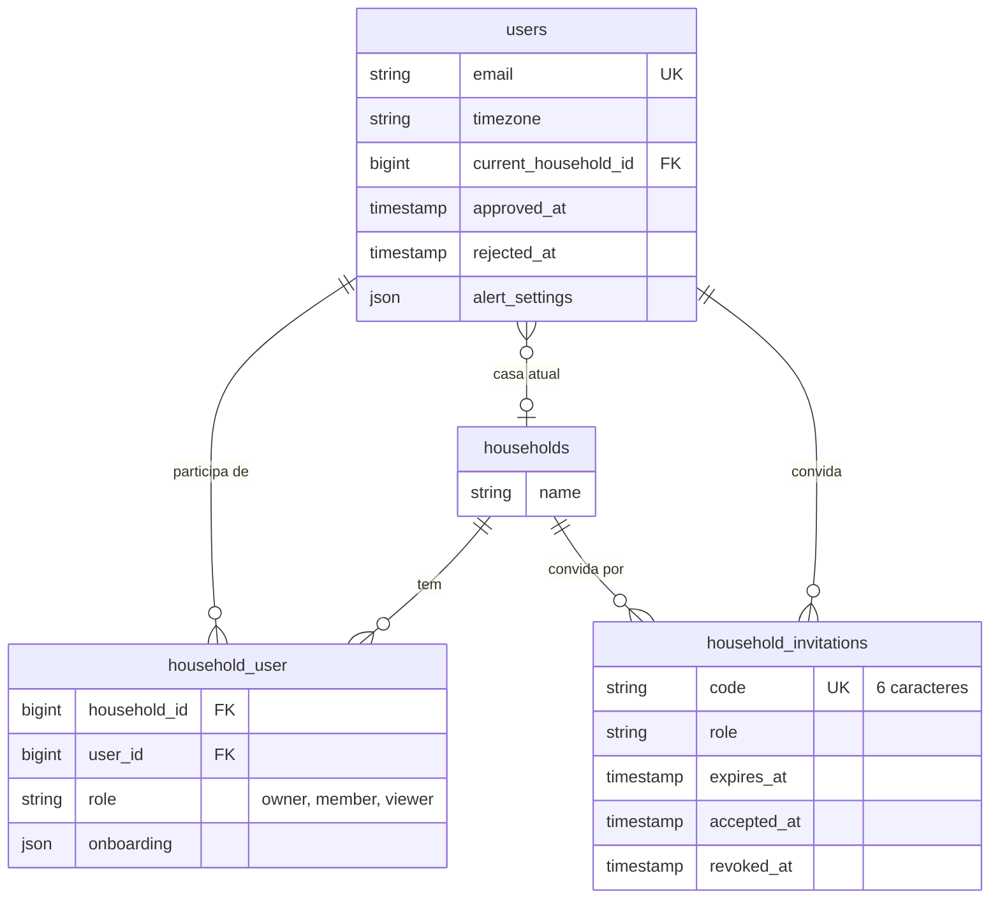
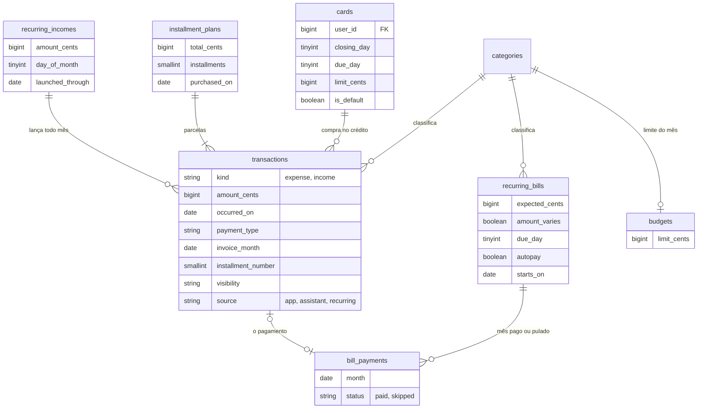
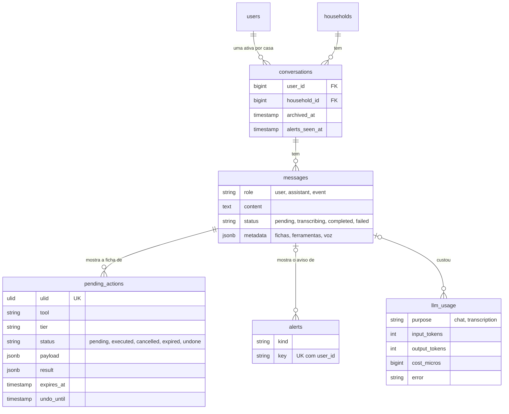

# 6. O modelo de dados

O banco é um PostgreSQL 16 com **20 tabelas do domínio**, criadas pelas 21 migrations de `backend/database/migrations/`, mais as tabelas de apoio do próprio Laravel (sessões, cache, fila, tokens). Este documento mostra as tabelas por assunto, as regras que valem para quase todas e, principalmente, **o que não é guardado**: boa parte dos números da tela é calculada na hora, e entender isso explica muitas decisões do código.

## As regras que valem para quase todas

| Regra | Onde aparece | Por quê |
|---|---|---|
| **Tudo pertence a uma casa** | `household_id` em 17 tabelas, quase todas com `cascadeOnDelete` | Apagar a casa apaga tudo dela (só o registro de custo da IA, `llm_usage`, fica, sem a casa). Os models com `BelongsToHousehold` filtram por essa coluna sozinhos ([backend](02-backend.md#a-casa-como-filtro)). |
| **Privado ou da casa** | `visibility` (`household` ou `private`) em `transactions`, `installment_plans`, `recurring_incomes`, `lists` e `reminders` | O escopo `HasVisibility` esconde o privado de quem não criou, em toda consulta. |
| **Quem criou** | `created_by` (anulável, `nullOnDelete`) | Quem sai da casa não leva os lançamentos junto: eles ficam, sem autor. Nos lembretes, a exclusão é em cascata. |
| **Arquivar em vez de apagar** | `archived_at` em `categories`, `cards`, `recurring_bills`, `recurring_incomes` e `conversations` | Os lançamentos antigos continuam apontando para a categoria e o cartão, e precisam do nome e da cor. |
| **Dinheiro em centavos inteiros** | Toda coluna `*_cents` é `bigInteger` | Sem `float`, sem erro de arredondamento. R$ 42,00 é `4200`. |
| **Data do dia × momento** | `date` para o que é do dia (`occurred_on`, `due_on`); `timestamp` em UTC para o que tem hora (`remind_at`) | O "dia" de um gasto não pode mudar com o fuso; o horário de um lembrete precisa de UTC para ser comparado. |
| **JSON onde a forma varia** | `jsonb` em `messages.metadata` e `pending_actions.payload/result`; `json` em `users.alert_settings` e `household_user.onboarding` | As fichas e os dados de cada ferramenta têm formatos diferentes; as preferências são poucas e mudam juntas. |

## Casa, pessoas e acesso

| Tabela | O que guarda |
|---|---|
| `users` | A conta: nome, e-mail, senha (hash), **fuso** (`timezone`, padrão `America/Sao_Paulo`), a **casa atual** (`current_household_id`), a liberação (`approved_at` ou `rejected_at`) e os avisos desligados (`alert_settings`). |
| `households` | Só o nome. Tudo o mais aponta para ela. |
| `household_user` | A participação (model `Membership`): quem está em qual casa e com que **papel**. Uma pessoa por casa (`unique`). O `onboarding` guarda os primeiros passos dessa pessoa nessa casa. |
| `household_invitations` | Os convites: código único, papel, validade de 7 dias e se foi aceito, por quem, ou revogado. |
| `personal_access_tokens` | Do Sanctum: um token por aparelho logado. |
| `password_reset_tokens` | Do Laravel: o hash do código de 6 números de "Esqueci a senha". |

## Dinheiro

| Tabela | O que guarda | Detalhe que importa |
|---|---|---|
| `transactions` | Cada gasto ou receita: tipo, valor, descrição, dia, categoria, forma de pagamento, cartão, quem lançou, de onde veio (`source`). | `invoice_month` é o 1º dia do mês da fatura em que a compra cai, gravado na hora pelo `TransactionService`. Índices por `(casa, dia)`, `(casa, cartão, fatura)` e `(casa, categoria)`, os filtros mais usados. |
| `categories` | Nome, tipo (despesa ou receita), ícone, cor (um dos 14 tons de pigmento) e a ordem (`position`). | Toda casa nasce com 13 de despesa e 3 de receita (`DefaultCategories`). |
| `cards` | O cartão de uma pessoa: dia de fechamento, de vencimento, limite, cor, se é o padrão dela. | É de uma pessoa (`user_id`), não da casa toda. |
| `installment_plans` | A compra parcelada: total, número de parcelas, data da compra. | Cada parcela é uma `transaction` com `installment_number`; elas mudam todas juntas. `Money::split` divide sem perder centavo. |
| `recurring_bills` | A conta fixa: nome, valor esperado (ou "varia todo mês"), dia de vencimento, débito automático, mês em que começa. | `autopay_through` marca até que mês o débito automático já tratou. |
| `bill_payments` | **Só** os meses pagos ou pulados de cada conta. | Um por conta e mês (`unique`). Apagar a despesa do pagamento apaga a linha, e o mês volta a ficar em aberto. |
| `recurring_incomes` | A receita fixa: descrição, valor, dia do mês, de quem é. | `launched_through` é o último mês lançado: nunca lança duas vezes, e um lançamento apagado de propósito não volta. |
| `budgets` | O limite por mês de uma categoria. | Um por categoria e casa (`unique`). Vale para todo mês, não para um mês só. |

## Organização: listas e lembretes

| Tabela | O que guarda | Detalhe |
|---|---|---|
| `lists` | Nome, tipo (`shopping`, `wishlist`, `todo`, `custom`), ícone, ordem, visibilidade. | `is_default` é a lista usada quando alguém diz só "coloca na lista"; uma por casa. Toda casa nasce com as listas padrão (`DefaultLists`). |
| `list_items` | O item: texto, quantidade, observação, preço, link, prazo, ordem, quando e por quem foi marcado. | O item não tem visibilidade própria: um escopo global (`whereHas('list')`) só deixa encontrar o item se a lista dele aparece para a pessoa. Índice por `(lista, checked_at)` para separar marcados de não marcados. |
| `reminders` | O texto, o próximo aviso (`remind_at`, UTC), a data base da série (`anchor_at`), a repetição ("a cada N" dias, semanas, meses ou anos), a visibilidade e quando foi concluído. | As repetições são contadas a partir de `anchor_at`, no fuso da pessoa, para "todo dia 5" não escorregar. |

## Assistente e avisos

| Tabela | O que guarda | Detalhe |
|---|---|---|
| `conversations` | A conversa de uma pessoa numa casa. "Limpar conversa" arquiva a atual. | **Uma ativa por pessoa e casa**, garantida por um índice parcial do PostgreSQL (`WHERE archived_at IS NULL`): as arquivadas não contam. `alerts_seen_at` faz o número da aba Chat. |
| `messages` | Cada mensagem: da pessoa (`user`), do assistente (`assistant`) ou do próprio app (`event`, os avisos). | `metadata` guarda as fichas (`cards`), as ferramentas chamadas (`tools`) e, na voz, a duração e o arquivo enquanto ele existe. |
| `pending_actions` | O que o assistente propôs: a ferramenta, o nível, os dados já validados (`payload`), o resultado depois de gravar (`result`, com o necessário para desfazer). | A URL usa o `ulid`, não o `id`: não dá para adivinhar a ação de outra pessoa somando 1. |
| `alerts` | Cada aviso mandado a uma pessoa: o tipo e a **chave** (`bill:12:2026-10:eve`). | `unique(user_id, key)`: a mesma chave nunca sai duas vezes. |
| `llm_usage` | Uma linha por rodada de IA ou transcrição: provedor, modelo, tokens, tempo, custo em milionésimos de dólar, erro. | Só para acompanhar custo e falhas; falhar ao gravar não derruba a resposta. |

## O que **não** é guardado

Esta é a parte que mais surpreende quem lê o banco pela primeira vez:

| O que aparece na tela | Como é obtido |
|---|---|
| **Os meses de uma conta fixa** ("Luz de novembro, em aberto") | Calculados a partir de `due_day` e `starts_on` pelo `BillService`. Só o mês pago ou pulado vira linha em `bill_payments`. Não existe "gerar os meses do ano". |
| **Uma fatura** | Não há tabela de faturas. É a soma das `transactions` daquele cartão com aquele `invoice_month`; o período sai do `InvoiceCalendar` e do `InvoicePeriod`. |
| **O saldo e o resumo do mês** | Somados na hora pelo `MonthSummary`, com os filtros da pessoa. Não há saldo de conta bancária: o app não tem esse conceito. |
| **Quanto já foi usado de um orçamento** | Somado na hora pelo `BudgetService`. A tabela `budgets` guarda só o limite. |
| **Os primeiros passos "feitos"** | Calculados pelo `OnboardingService` olhando os cadastros (ter cartão, receita fixa…). Só o que a pessoa escolheu (ignorar, conferir) vai para o `onboarding`. |
| **O texto ao vivo de uma resposta** | Vai pelo WebSocket aos pedaços e só é gravado inteiro no fim. |

> **Para explicar:** "O banco guarda fatos (este gasto, esta conta foi paga em outubro) e calcula o resto quando alguém pergunta. Uma fatura é só a soma das compras daquele cartão naquele mês, e os meses de uma conta fixa nascem da data de vencimento. Assim nunca há dois lugares dizendo coisas diferentes sobre o mesmo número."

## As tabelas de apoio

Vêm do Laravel e não fazem parte do domínio: `sessions` (das páginas web, como a de aprovação; o app entra por token), `cache` e `cache_locks`, `jobs`, `job_batches` e `failed_jobs`, e `personal_access_tokens` (Sanctum).

No `.env.example`, a fila e o cache usam o Redis (`QUEUE_CONNECTION=redis`, `CACHE_STORE=redis`), então `jobs` e `cache` ficam vazias nesse ambiente; elas existem porque vêm com o Laravel. O `backend/.env.production.example` mantém o Redis para os dois em produção.
